# 🐺 TỔNG HỢP TOÀN BỘ LUẬT CHƠI VÀ CẨM NANG NHÂN VẬT MA SÓI (WEREWOLF)

> **Tài liệu chuẩn dành cho Quản Trò (Game Master)**
> *Nguồn tham khảo dữ liệu & hình ảnh lá bài*: [https://thuthuatchoi.com/tong-hop-nhan-vat-trong-ma-soi-co-ban-va-cac-ban-mo-rong.html](https://thuthuatchoi.com/tong-hop-nhan-vat-trong-ma-soi-co-ban-va-cac-ban-mo-rong.html)
> *Giao diện thiết kế chuẩn hóa*: Phong cách Quản Trò Ma Sói (One Night Ultimate Werewolf Manager) hiển thị theo **Thứ tự thức dậy (Wake-up Order)** với thẻ bài tóm tắt và chỉ số phe phái.

---

## 📑 MỤC LỤC
1. [Quy Trình & Luật Chơi Cơ Bản Cho Quản Trò](#1-quy-trình--luật-chơi-cơ-bản-cho-quản-trò)
2. [Điều Kiện Thắng Của Các Phe (Win Conditions)](#2-điều-kiện-thắng-của-các-phe-win-conditions)
3. [Quy Chuẩn Thiết Kế Thẻ Bài Quản Trò (Card UI Standard)](#3-quy-chuẩn-thiết-kế-thẻ-bài-quản-trò-card-ui-standard)
4. [Bảng Thứ Tự Thức Dậy Ban Đêm (Night Wake-up Order)](#4-bảng-thứ-tự-thức-dậy-ban-đêm-night-wake-up-order)
5. [Danh Sách Chi Tiết 50+ Nhân Vật Theo Các Bản Mở Rộng](#5-danh-sách-chi-tiết-50-nhân-vật-theo-các-bản-mở-rộng)
   - [Phần 1: Nhân Vật Trong Ma Sói Cơ Bản](#phần-1-nhân-vật-trong-ma-sói-cơ-bản-the-werewolves-of-millers-hollow)
   - [Phần 2: Nhân Vật Trong Ma Sói New Moon (Trăng Non)](#phần-2-nhân-vật-trong-ma-sói-new-moon-trăng-non)
   - [Phần 3: Nhân Vật Trong Ma Sói The Village (Ngôi Làng)](#phần-3-nhân-vật-trong-ma-sói-the-village-ngôi-làng)
   - [Phần 4: Nhân Vật Trong Ma Sói Characters](#phần-4-nhân-vật-trong-ma-sói-characters)
   - [Phần 5: Nhân Vật Trong Ma Sói Character Plus](#phần-5-nhân-vật-trong-ma-sói-character-plus)
6. [Gợi Ý Thiết Lập Bàn Chơi Cho Quản Trò (Presets)](#6-gợi-ý-thiết-lập-bàn-chơi-cho-quản-trò-presets)

---

## 1. QUY TRÌNH & LUẬT CHƠI CƠ BẢN CHO QUẢN TRÒ

### 1.1. Chuẩn Bị & Phát Thẻ
- Quản trò xác định số lượng người chơi (từ 6 đến 30+ người).
- Lựa chọn các lá bài chức năng cân bằng giữa phe **Dân Làng** và **Ma Sói** (tỷ lệ chuẩn: khoảng 1 Sói trên 3-4 Dân làng).
- Xáo đều bài và phát bí mật cho mỗi người chơi 1 lá. Mỗi người chỉ được xem bài của mình và úp xuống trước mặt.

### 1.2. Chu Kỳ Trò Chơi (Ban Đêm & Ban Ngày)
Trò chơi luân phiên diễn ra qua 2 giai đoạn chính liên tục cho đến khi có phe chiến thắng:

#### 🌙 Giai Đoạn Ban Đêm (Đêm Xuống)
1. **Quản trò hô**: *'Trời tối rồi, tất cả mọi người đi ngủ (nhắm mắt lại, cúi đầu xuống)'*.
2. Quản trò lần lượt gọi từng nhân vật có chức năng thức dậy theo **Thứ tự thức dậy (Wake-up Order)** đã được quy định sẵn.
3. Các nhân vật thức dậy KHÔNG ĐƯỢC PHÁT RA TIẾNG ĐỘNG, chỉ giao tiếp bằng cử chỉ tay hoặc ánh mắt với Quản trò.
4. Quản trò ghi chép lại các hành động: ai được bảo vệ, ai bị soi, ai bị Sói cắn, ai bị trúng độc, v.v.

#### ☀️ Giai Đoạn Ban Ngày (Trời Sáng)
1. **Quản trò hô**: *'Trời sáng rồi, tất cả mọi người thức dậy!'*.
2. Quản trò công bố tình hình thương vong trong đêm:
   - Nếu có người chết: Công bố danh tính người bị loại. Người chết không được tiết lộ bài và phải giữ im lặng đến hết ván.
   - Nếu không ai chết (do Bảo Vệ cứu, Phù Thủy hồi sinh, v.v.): Thông báo một đêm bình yên vô sự.
3. **Thảo luận công khai**: Cả làng có khoảng 3-5 phút để tranh luận, chất vấn, biện minh và tìm ra kẻ đáng ngờ.
4. **Biểu quyết treo cổ (Voting)**:
   - Quản trò đếm 1, 2, 3: Mọi người đồng thời chỉ tay vào người mình muốn treo cổ.
   - Người nhận được nhiều phiếu nhất sẽ bước lên giàn treo cổ và có 30 giây để nói lời trăn trối cuối cùng.
   - Làng bỏ phiếu phán quyết cuối cùng (Đồng ý giết hay Tha bổng). Nếu đồng ý, người đó bị loại khỏi ván chơi.
   - **Quy tắc hòa phiếu**: Nếu số phiếu cao nhất bị hòa, không ai bị treo cổ (trừ khi có Người Thế Thân trong bàn chơi).

---

## 2. ĐIỀU KIỆN THẮNG CỦA CÁC PHE (WIN CONDITIONS)

| Ký Hiệu | Phe Phái (Team) | Màu Nhận Diện | Điều Kiện Chiến Thắng (Win Condition) |
|:---:|:---|:---:|:---|
| **[V]** | **Phe Dân Làng** *(Villager Team)* | 🔵 Xanh Dương / Tím | **Chiến thắng khi toàn bộ Ma Sói bị tiêu diệt hoàn toàn** (hoặc trong bản One Night: tiêu diệt ít nhất 1 Ma Sói, hoặc không có Sói và không ai bị giết). |
| **[W]** | **Phe Ma Sói** *(Werewolf Team)* | 🔴 Đỏ | **Chiến thắng khi số lượng Ma Sói bằng hoặc nhiều hơn số lượng Dân Làng còn sống**, hoặc toàn bộ Dân Làng bị tiêu diệt sạch. |
| **[3]** | **Phe Thứ Ba / Độc Lập** *(Neutral / 3rd Party)* | 🟣 Tím Đậm / Vàng | Có điều kiện thắng riêng biệt độc lập (ví dụ: **Sói Trắng** là người sống sót duy nhất; **Người Thổi Sáo** thôi miên được toàn bộ người còn sống; **Cặp Đôi khác phe** là 2 người cuối cùng; **Thiên Sứ** bị treo cổ ngay ngày 1). |
| **[?]** | **Biến Đổi / Kế Thừa** *(Variable)* | ⚪ Xám / Hai màu | Điều kiện thắng thay đổi theo quá trình chơi (ví dụ: Ăn Trộm đổi bài, Đứa Trẻ Hoang Dã hóa Sói khi Thần Tượng chết, Kẻ Báo Thù chọn phe...). |

---

## 3. QUY CHUẨN THIẾT KẾ THẺ BÀI QUẢN TRÒ (CARD UI STANDARD)
> **Thiết kế mô phỏng theo mẫu One Night Ultimate Werewolf Manager**

Mỗi lá bài hiển thị trên website quản lý ván chơi của Quản trò sẽ có bố cục gồm 4 phần trực quan:
```text
+-----------------------------------------+
|  [TÊN NHÂN VẬT - ROLE NAME]             | <- Thanh tiêu đề màu sắc theo vai trò
+-----------------------------------------+
|                                         |
|           [HÌNH ẢNH LÁ BÀI]             | <- Ảnh minh họa thẻ bài chính thức
|                                         |
+-----------------------------------------+
|  Tóm tắt kỹ năng ngắn gọn               | <- 1-2 dòng giải thích súc tích
|                                    [V]  | <- Badge ký hiệu phe (V: Dân, W: Sói, 3: Thứ 3)
+-----------------------------------------+
                    x1                      <- Bộ đếm số lượng lá trong ván
```

---

## 4. BẢNG THỨ TỰ THỨC DẬY BAN ĐÊM (NIGHT WAKE-UP ORDER)
Quản trò điều hành ván chơi theo đúng trình tự số học dưới đây để tránh trùng lặp hoặc xung đột kỹ năng:

| Thứ Tự (#) | Tên Nhân Vật | Phe | Tần Suất | Hành Động Của Quản Trò |
|:---:|:---|:---:|:---:|:---|
| **0** | **Ăn Trộm** | `?` Tùy Chọn / Biến Đổi | Đêm đầu tiên | Đêm đầu tiên thức dậy xem 2 lá bài thừa ngoài bàn cờ và chọn 1 lá để n... |
| **0.2** | **Nguyệt Nữ** | `V` Phe Dân Làng | Đầu mỗi đêm | Đầu mỗi đêm thức dậy chọn 1 người để phong ấn, người đó sẽ bị vô hiệu ... |
| **0.4** | **Ảnh Tử (Bóng Ma)** | `?` Tùy Thuộc / Kế Thừa | Đêm đầu tiên | Đêm đầu chọn 1 người làm bản thể. Nếu người đó sống đến cuối, Ảnh Tử t... |
| **0.5** | **Diễn Viên** | `?` Tùy Chọn / Biến Đổi | Trong 3 đêm đầu | Để 3 lá bài thừa ngoài cuộc. Trong 3 đêm đầu, Diễn Viên có thể chọn tr... |
| **0.6** | **Kẻ Báo Thù** | `?` Tự Chọn Phe (Dân hoặc Sói) | Đêm đầu chọn phe | Đêm đầu bí mật chọn theo Dân hoặc Sói. Khi Kẻ Báo Thù chết, được chọn ... |
| **0.8** | **Chó Sói / Bán Sói / Sói Lai** | `?` Tự Chọn (Dân hoặc Sói) | Đêm đầu tiên | Vào đêm đầu tiên, được tự ý lựa chọn muốn trở thành Dân Làng lương thi... |
| **1** | **Cupid (Thần Tình Yêu)** | `V` Phe Dân Làng (Có thể tạo Phe Thứ 3) | Chỉ đêm đầu tiên | Đêm đầu tiên ghép đôi 2 người bất kỳ yêu nhau. Nếu 1 người chết, người... |
| **1.5** | **Đứa Trẻ Hoang Dã** | `?` Biến Đổi (Phe Dân -> Phe Sói) | Đêm 1 chọn thần tượng | Đêm đầu tiên chọn 1 người chơi làm Thần Tượng. Nếu Thần Tượng chết tro... |
| **2** | **Hai Chị Em** | `V` Phe Dân Làng | Mỗi đêm (hoặc đêm đầu) | Hai người chơi giữ thẻ Hai Chị Em thức dậy nhận diện nhau vào ban đêm,... |
| **2.1** | **Ba Anh Em** | `V` Phe Dân Làng | Đêm đầu tiên | Ba người chơi giữ lá Ba Anh Em thức dậy nhận diện nhau vào ban đêm, tạ... |
| **3** | **Bảo Vệ** | `V` Phe Dân Làng | Mỗi đêm | Mỗi đêm bảo vệ 1 người không bị Sói cắn chết (có thể tự bảo vệ mình, k... |
| **3.2** | **Thầy Thôi Miên** | `V` Phe Dân Làng | Mỗi đêm | Mỗi đêm mê hoặc 1 người. Nếu đêm đó Thầy Thôi Miên bị chết, người bị m... |
| **3.5** | **Bà Đồng** | `V` Phe Dân Làng | 5 lần trong ván | Có tối đa 5 lần gọi hồn trong ván. Quản trò đọc 4 câu hỏi từ lá Gọi Hồ... |
| **3.8** | **Người Gọi Hồn** | `V` Phe Dân Làng | Mỗi đêm | Mỗi đêm Quản trò hỏi linh hồn người vừa chết gần nhất: 'Hãy chỉ vào kẻ... |
| **4** | **Tiên Tri** | `V` Phe Dân Làng | Mỗi đêm | Mỗi đêm thức dậy soi danh tính 1 người chơi. Quản trò báo cho biết ngư... |
| **4.1** | **Cáo** | `V` Phe Dân Làng | Mỗi đêm | Mỗi đêm chọn nhóm 3 người chơi ngồi liền kề. Nếu có ít nhất 1 Sói thì ... |
| **4.9** | **Người Múa Rối** | `V` Phe Dân / Phe Sói (Tùy bản) | 1 lần trong ván | Một lần duy nhất trong cả ván chơi, có quyền ép bầy Sói phải ăn thịt 1... |
| **5** | **Cô Bé** | `V` Phe Dân Làng | Trong lúc Sói thức | Có quyền hé mắt lén nhìn khi bầy Sói thức dậy để tìm ra Sói. Nếu bị Só... |
| **5** | **Sói Thường (Ma Sói)** | `W` Phe Sói | Mỗi đêm | Mỗi đêm cùng bầy Sói thức dậy, thống nhất chọn cắn chết 1 người dân. B... |
| **5** | **Sói Con** | `W` Phe Sói | Mỗi đêm | Thức dậy chung với bầy Sói. Khi Sói Con bị chết, vào đêm tiếp theo bầy... |
| **5.1** | **Sói Lớn Xấu Xa** | `W` Phe Sói | Mỗi đêm | Thuộc phe Sói. Cho đến khi chưa có bất kỳ con Sói nào (kể cả Sói lai, ... |
| **5.2** | **Người Cha Của Sói (Sói Đầu Đàn)** | `W` Phe Sói | Mỗi đêm | Thuộc phe Sói. Một lần duy nhất trong ván, sau khi Sói cắn người, có t... |
| **5.3** | **Anh Em Sói** | `W` Phe Sói | Đêm đầu nhận nhau | Gồm Sói Anh và Sói Em. Sói Anh dậy đi săn bình thường. Sói Em chưa thứ... |
| **5.5** | **Sói Trắng** | `3` Phe Thứ 3 (Độc Lập) | Cứ 2 đêm 1 lần | Thức dậy chung với Sói thường. Cứ 2 đêm 1 lần, thức dậy riêng để giết ... |
| **5.8** | **Sói Lửa (Cáo Lửa)** | `W` Phe Sói | Khi có đồng bọn chết | Khi có ít nhất 1 Sói chết, đêm tiếp theo Sói Lửa được chọn 1 người để ... |
| **6** | **Phù Thủy** | `V` Phe Dân Làng | Mỗi đêm | Sở hữu 2 bình thuốc: 1 bình cứu sống người bị Sói cắn, 1 bình độc giết... |
| **6.5** | **Dược Sĩ** | `V` Phe Dân Làng | Mỗi đêm | Có 2 bình dùng 1 lần: Bình Thuốc Mê (cấm 1 người nói và cấm vote trong... |
| **7** | **Người Thổi Sáo** | `3` Phe Thứ 3 (Độc Lập) | Mỗi đêm | Mỗi đêm thôi miên 2 người. Những người bị thôi miên nhận diện nhau. Th... |
| **7.5** | **Sát Thủ (Thích Khách)** | `3` Phe Độc Lập / Phục Thù | Mỗi 2 đêm khi đủ 4 phiếu | Mỗi 2 đêm, nếu số phiếu biểu quyết vào Sát Thủ trong các ngày qua đạt ... |
| **8** | **Kẻ Đốt Nhà (Hỏa Hoạn)** | `W` Phe Sói / Phá Hoại | Mỗi đêm | Chọn phóng hỏa đốt 1 ngôi nhà. Nếu nhà đó là nơi Sói cắn nạn nhân, con... |
| **9** | **Con Quạ (The Village)** | `V` Phe Dân Làng | Cuối mỗi đêm | Mỗi đêm đặt thẻ 'Chỉ định' trước cửa 1 người chơi. Sáng hôm sau người ... |
| **9.1** | **Con Quạ (Plus)** | `V` Phe Dân Làng | Mỗi đêm | Hằng đêm đặt lời nguyền lên 1 người. Người bị dính lời nguyền sáng hôm... |
| **85 - 99** | *Các nhân vật kích hoạt ban ngày / khi chết* (Kị Sĩ, Thợ Săn, Già Làng, Thằng Ngốc, Cảnh Sát Trưởng...) | - | Ban ngày / Thụ động | Kích hoạt theo tình huống cụ thể |

---

## 5. DANH SÁCH CHI TIẾT 50+ NHÂN VẬT THEO CÁC BẢN MỞ RỘNG

### Phần 1: Nhân Vật Trong Ma Sói Cơ Bản (The Werewolves of Millers Hollow)

#### 🎴 Dân Làng *(Simple Villager)*
- **Phe**: `V` **Phe Dân Làng**
- **Thứ tự thức dậy ban đêm**: `#99` (Không thức dậy)
- **Tóm tắt hiển thị thẻ bài (Card Badge Text)**: *Không có năng lực đặc biệt trong đêm. Cùng dân làng suy luận, thảo luận và bỏ phiếu tìm Ma Sói vào ban ngày.*
- **Hình ảnh lá bài**:
  - Local file: ``
  - Nguồn trực tuyến: ``

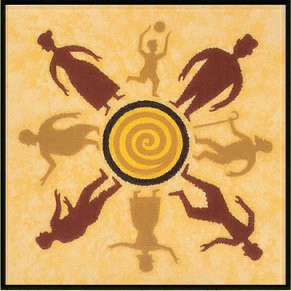

**📖 Chi tiết kỹ năng & Vai trò:**
Dân làng chiếm đại đa số trong các nhân vật. Nhiệm vụ của Dân làng là tìm ra ai là Ma Sói đang trà trộn trong dân chúng để đưa lên giàn treo cổ vào ban ngày. Dân làng cần vận dụng suy luận logic, phân tích biểu cảm và lời nói của người khác để đưa ra quyết định chính xác.

**🗣️ Kịch bản Quản trò gọi dậy (GM Call):**
> *"Không gọi thức dậy vào ban đêm."*

**⚠️ Lưu ý quan trọng cho Quản trò:**
- Bị chết nếu bị Ma Sói cắn trúng trong đêm hoặc bị dân làng bỏ phiếu treo cổ ban ngày.
- Sức mạnh của Dân làng nằm ở lá phiếu và khả năng lập luận sắc bén.

---

#### 🎴 Tiên Tri *(Seer)*
- **Phe**: `V` **Phe Dân Làng**
- **Thứ tự thức dậy ban đêm**: `#4` (Mỗi đêm)
- **Tóm tắt hiển thị thẻ bài (Card Badge Text)**: *Mỗi đêm thức dậy soi danh tính 1 người chơi. Quản trò báo cho biết người đó có phải là Sói hay không.*
- **Hình ảnh lá bài**:
  - Local file: ``
  - Nguồn trực tuyến: ``

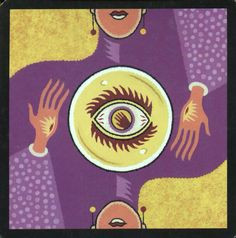

**📖 Chi tiết kỹ năng & Vai trò:**
Mỗi đêm, Tiên Tri được Quản trò gọi thức dậy và được quyền chỉ tay vào một người chơi bất kỳ để kiểm tra thân phận. Quản trò sẽ ra dấu ngầm (gật đầu/giơ ngón tay cái nếu là Ma Sói, lắc đầu nếu là Dân làng hoặc phe khác).

**🗣️ Kịch bản Quản trò gọi dậy (GM Call):**
> *"Quản trò hô: 'Tiên Tri thức dậy. Hãy chọn một người để soi.' -> Tiên tri chỉ tay -> Quản trò ra dấu hiệu -> 'Tiên Tri nhắm mắt lại.'"*

**⚠️ Lưu ý quan trọng cho Quản trò:**
- Nhiệm vụ của Tiên Tri là dẫn dắt dân làng bỏ phiếu đúng Sói nhưng phải ẩn mình khéo léo để không bị Sói phát hiện và cắn chết vào đêm tiếp theo.
- Sẽ bị chết nếu bị Ma Sói cắn trúng mà không được Bảo Vệ hoặc Phù Thủy cứu.

---

#### 🎴 Bảo Vệ *(Bodyguard / Defender)*
- **Phe**: `V` **Phe Dân Làng**
- **Thứ tự thức dậy ban đêm**: `#3` (Mỗi đêm)
- **Tóm tắt hiển thị thẻ bài (Card Badge Text)**: *Mỗi đêm bảo vệ 1 người không bị Sói cắn chết (có thể tự bảo vệ mình, không chọn 1 người 2 đêm liên tiếp).*
- **Hình ảnh lá bài**:
  - Local file: ``
  - Nguồn trực tuyến: ``

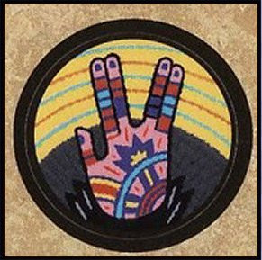

**📖 Chi tiết kỹ năng & Vai trò:**
Mỗi đêm Quản trò sẽ gọi Bảo Vệ thức dậy. Nhiệm vụ của Bảo Vệ là lựa chọn 1 người để bảo vệ an toàn khỏi nanh vuốt của Ma Sói. Bảo Vệ có thể chọn tự bảo vệ chính mình. Người được Bảo Vệ lựa chọn nếu bị Ma Sói cắn trong đêm đó sẽ vẫn bình an vô sự vào sáng hôm sau.

**🗣️ Kịch bản Quản trò gọi dậy (GM Call):**
> *"Quản trò hô: 'Bảo Vệ thức dậy. Hãy chọn một người bạn muốn bảo hộ đêm nay.' -> Bảo Vệ chỉ tay -> Quản trò ghi nhận -> 'Bảo Vệ nhắm mắt lại.'"*

**⚠️ Lưu ý quan trọng cho Quản trò:**
- Bảo Vệ KHÔNG được phép bảo vệ cùng một người chơi trong 2 đêm liên tiếp.
- Lưu ý quan trọng: Người được Bảo Vệ bảo vệ chỉ miễn nhiễm vết cắn của Ma Sói, vẫn có thể chết do bình thuốc độc của Phù Thủy hoặc bị Thợ Săn bắn.

---

#### 🎴 Thợ Săn *(Hunter)*
- **Phe**: `V` **Phe Dân Làng**
- **Thứ tự thức dậy ban đêm**: `#98` (Khi chết)
- **Tóm tắt hiển thị thẻ bài (Card Badge Text)**: *Khi bị loại (bị Sói cắn hoặc bị treo cổ), lập tức nổ súng bắn chết thêm 1 người chơi khác theo ý mình.*
- **Hình ảnh lá bài**:
  - Local file: ``
  - Nguồn trực tuyến: ``

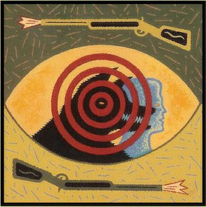

**📖 Chi tiết kỹ năng & Vai trò:**
Thợ Săn là một vị trí có sức mạnh răn đe cực lớn của phe Dân Làng. Khi Thợ Săn bị chết (dù là bị Ma Sói cắn chết trong đêm, bị treo cổ ban ngày, hay bị Phù Thủy đầu độc), trước khi rời cuộc chơi Thợ Săn có quyền nổ một phát súng chỉ định 1 người chơi bất kỳ cùng chết theo mình.

**🗣️ Kịch bản Quản trò gọi dậy (GM Call):**
> *"Khi công bố Thợ Săn chết: 'Thợ Săn đã chết. Thợ Săn có quyền nổ một phát súng kéo theo một người.' -> Thợ Săn chỉ định nạn nhân."*

**⚠️ Lưu ý quan trọng cho Quản trò:**
- Người bị Thợ Săn bắn sẽ chết ngay lập tức và không thể được cứu.
- Nếu Thợ Săn bị chết vì tình yêu (người yêu trong cặp đôi Cupid chết), Thợ Săn vẫn được bắn phát súng cuối cùng.

---

#### 🎴 Phù Thủy *(Witch)*
- **Phe**: `V` **Phe Dân Làng**
- **Thứ tự thức dậy ban đêm**: `#6` (Mỗi đêm)
- **Tóm tắt hiển thị thẻ bài (Card Badge Text)**: *Sở hữu 2 bình thuốc: 1 bình cứu sống người bị Sói cắn, 1 bình độc giết chết 1 người. Mỗi bình chỉ dùng 1 lần cả ván.*
- **Hình ảnh lá bài**:
  - Local file: ``
  - Nguồn trực tuyến: ``

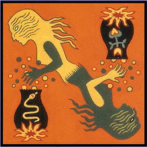

**📖 Chi tiết kỹ năng & Vai trò:**
Phù Thủy sở hữu hai bình thần dược ma thuật cực mạnh: một bình Cứu người (màu trắng/hồi sinh) và một bình Giết người (màu đen/thuốc độc). Mỗi đêm sau khi Sói hành động xong, Quản trò gọi Phù Thủy dậy và ra dấu cho biết ai vừa bị Sói cắn. Phù Thủy có quyền dùng bình cứu để giữ mạng cho người đó, hoặc dùng bình độc để tiêu diệt một người mình nghi ngờ, hoặc không dùng gì cả.

**🗣️ Kịch bản Quản trò gọi dậy (GM Call):**
> *"Quản trò hô: 'Phù Thủy thức dậy. Đêm nay người này bị Sói cắn (Quản trò chỉ vào nạn nhân). Bạn có muốn dùng bình cứu không? (Phù Thủy ra hiệu Có/Không). Bạn có muốn dùng bình độc không? (Nếu có thì chỉ tay vào người muốn đầu độc).' -> 'Phù Thủy nhắm mắt lại.'"*

**⚠️ Lưu ý quan trọng cho Quản trò:**
- Mỗi bình thuốc chỉ được sử dụng đúng 1 lần trong toàn bộ ván chơi. Phù Thủy có thể dùng cả 2 bình trong cùng một đêm.
- Nếu đêm đó Bảo Vệ đã bảo vệ đúng nạn nhân của Sói, Quản trò sẽ ra dấu lắc tay báo không có ai bị thương/chết.
- Dù đã dùng hết 2 bình thuốc, mỗi đêm Phù Thủy vẫn được gọi dậy để biết nạn nhân của Sói nhưng không thể can thiệp.

---

#### 🎴 Cupid (Thần Tình Yêu) *(Cupid)*
- **Phe**: `V` **Phe Dân Làng (Có thể tạo Phe Thứ 3)**
- **Thứ tự thức dậy ban đêm**: `#1` (Chỉ đêm đầu tiên)
- **Tóm tắt hiển thị thẻ bài (Card Badge Text)**: *Đêm đầu tiên ghép đôi 2 người bất kỳ yêu nhau. Nếu 1 người chết, người kia chết theo. Khác phe sẽ thành Phe Thứ 3.*
- **Hình ảnh lá bài**:
  - Local file: ``
  - Nguồn trực tuyến: ``

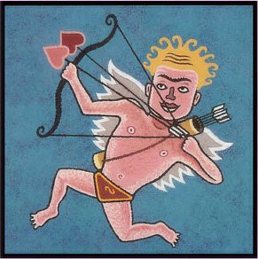

**📖 Chi tiết kỹ năng & Vai trò:**
Đầu ván (chỉ trong đêm đầu tiên), Cupid thức dậy và bắn 2 mũi tên tình yêu ghép đôi hai người chơi bất kỳ. Cupid có thể tự ghép đôi cho bản thân với người khác. Sau khi Cupid nhắm mắt, Quản trò cho hai người được ghép đôi thức dậy nhìn mặt nhau.

**🗣️ Kịch bản Quản trò gọi dậy (GM Call):**
> *"Quản trò hô: 'Cupid thức dậy. Hãy chọn hai người yêu nhau.' -> Cupid chọn 2 người -> 'Cupid nhắm mắt lại.' -> 'Hai người yêu nhau thức dậy nhận diện nhau.' -> 'Hai người yêu nhau nhắm mắt lại.'"*

**⚠️ Lưu ý quan trọng cho Quản trò:**
- Nếu một trong hai người yêu nhau chết (dù bằng bất cứ nguyên nhân gì), người còn lại đau buồn chết theo ngay lập tức.
- Nếu 2 người yêu nhau cùng phe (Dân + Dân hoặc Sói + Sói), họ giữ nguyên điều kiện thắng của phe mình.
- ĐẶC BIỆT: Nếu 1 Sói yêu 1 Dân, cả hai trở thành PHE THỨ 3 độc lập. Mục tiêu thắng duy nhất của họ là tiêu diệt toàn bộ người chơi khác để trở thành 2 người sống sót cuối cùng!

---

#### 🎴 Cảnh Sát Trưởng / Trưởng Làng *(Sheriff / Mayor)*
- **Phe**: `V` **Tất Cả Phe (Chức vị phong thêm)**
- **Thứ tự thức dậy ban đêm**: `#97` (Bầu chọn ban ngày)
- **Tóm tắt hiển thị thẻ bài (Card Badge Text)**: *Chức vị do làng bầu chọn vào ban ngày. Phiếu bầu treo cổ của Cảnh Sát Trưởng tính bằng 2 phiếu. Khi chết được di chúc lại.*
- **Hình ảnh lá bài**:
  - Local file: ``
  - Nguồn trực tuyến: ``

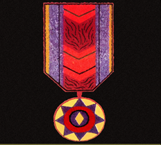

**📖 Chi tiết kỹ năng & Vai trò:**
Đây là danh hiệu bổ sung được trao cho một người chơi thông qua cuộc bỏ phiếu công khai của cả làng vào ngày đầu tiên. Phiếu biểu quyết của Cảnh Sát Trưởng có trọng số gấp đôi (tính bằng 2 phiếu). Khi có tình huống biểu quyết hòa phiếu, quyền quyết định tối hậu thuộc về Cảnh Sát Trưởng.

**🗣️ Kịch bản Quản trò gọi dậy (GM Call):**
> *"Ban ngày sau khi thảo luận xong: 'Cả làng tiến hành bầu Cảnh Sát Trưởng.' Khi Cảnh Sát Trưởng chết: 'Cảnh Sát Trưởng hãy chỉ định người kế nhiệm huy hiệu.'"*

**⚠️ Lưu ý quan trọng cho Quản trò:**
- Bất kỳ ai (dù là Dân, Sói hay Phe thứ 3) đều có thể được bầu làm Cảnh Sát Trưởng.
- Khi Cảnh Sát Trưởng bị loại khỏi cuộc chơi, người đó có toàn quyền di chúc chuyển lại huy hiệu cho bất kỳ ai còn sống.

---

#### 🎴 Cô Bé *(Little Girl)*
- **Phe**: `V` **Phe Dân Làng**
- **Thứ tự thức dậy ban đêm**: `#5` (Trong lúc Sói thức)
- **Tóm tắt hiển thị thẻ bài (Card Badge Text)**: *Có quyền hé mắt lén nhìn khi bầy Sói thức dậy để tìm ra Sói. Nếu bị Sói bắt gặp sẽ chết ngay.*
- **Hình ảnh lá bài**:
  - Local file: ``
  - Nguồn trực tuyến: ``

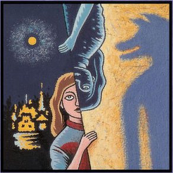

**📖 Chi tiết kỹ năng & Vai trò:**
Cô Bé là một quân bài tình báo cực kỳ quan trọng của Dân Làng. Từ đêm thứ hai trở đi, khi Quản trò gọi bầy Ma Sói thức dậy săn mồi, Cô Bé có quyền hí mắt (hé mở mắt nhìn trộm) để nhận diện danh tính của những con Sói.

**🗣️ Kịch bản Quản trò gọi dậy (GM Call):**
> *"Quản trò gọi Ma Sói dậy săn mồi, đồng thời quan sát bí mật xem Cô Bé có bị lộ không."*

**⚠️ Lưu ý quan trọng cho Quản trò:**
- Cô Bé phải hết sức khéo léo và thận trọng. Nếu bất kỳ con Sói nào phát hiện Cô Bé đang nhìn trộm, Sói có thể ra hiệu cho Quản trò để giết chết Cô Bé ngay trong đêm thay vì nạn nhân bình thường.
- Cô Bé không được phép giả vờ làm Sói để giơ tay chỉ người.

---

#### 🎴 Sói Thường (Ma Sói) *(Werewolf)*
- **Phe**: `W` **Phe Sói**
- **Thứ tự thức dậy ban đêm**: `#5` (Mỗi đêm)
- **Tóm tắt hiển thị thẻ bài (Card Badge Text)**: *Mỗi đêm cùng bầy Sói thức dậy, thống nhất chọn cắn chết 1 người dân. Ban ngày giả dạng dân làng để trà trộn.*
- **Hình ảnh lá bài**:
  - Local file: ``
  - Nguồn trực tuyến: ``

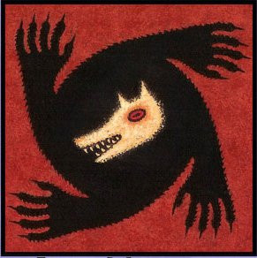

**📖 Chi tiết kỹ năng & Vai trò:**
Các con Ma Sói tạo thành một bầy đoàn kết. Mỗi đêm khi Quản trò gọi, toàn bộ bầy Sói mở mắt, nhìn nhận đồng bọn và dùng ám hiệu im lặng để thống nhất chọn ra 1 nạn nhân xấu số để cắn chết. Sáng hôm sau người này sẽ bị loại khỏi cuộc chơi.

**🗣️ Kịch bản Quản trò gọi dậy (GM Call):**
> *"Quản trò hô: 'Ma Sói thức dậy. Hãy nhận diện đồng bọn và chọn con mồi đêm nay.' -> Bầy Sói chỉ tay thống nhất nạn nhân -> Quản trò ghi nhận -> 'Ma Sói nhắm mắt lại.'"*

**⚠️ Lưu ý quan trọng cho Quản trò:**
- Sói có thể chọn không cắn ai trong đêm nếu muốn tạo kế nghi binh.
- Sói cũng có thể tự cắn đồng bọn của mình để đánh lừa Tiên Tri và dân làng.
- Điều kiện thắng: Khi số lượng Sói bằng hoặc lớn hơn số lượng Dân làng còn sống.

---

#### 🎴 Sói Con *(Wolf Pup)*
- **Phe**: `W` **Phe Sói**
- **Thứ tự thức dậy ban đêm**: `#5` (Mỗi đêm)
- **Tóm tắt hiển thị thẻ bài (Card Badge Text)**: *Thức dậy chung với bầy Sói. Khi Sói Con bị chết, vào đêm tiếp theo bầy Sói phẫn nộ được cắn 2 người liên tục.*
- **Hình ảnh lá bài**:
  - Local file: ``
  - Nguồn trực tuyến: ``


**📖 Chi tiết kỹ năng & Vai trò:**
Sói Con là thành viên nhỏ tuổi nhất trong đàn Sói. Hằng đêm, Sói Con thức dậy cùng Sói Thường và tham gia biểu quyết cắn người. Điểm đặc biệt: Nếu Sói Con bị dân làng treo cổ hoặc bị giết chết, đêm hôm sau bầy Sói vì trả thù sẽ được Quản trò cho phép cắn chết 2 nạn nhân liên tiếp.

**🗣️ Kịch bản Quản trò gọi dậy (GM Call):**
> *"Thức dậy chung với Sói Thường. Nếu Sói Con chết đêm trước, đêm nay Quản trò cho bầy Sói chọn 2 nạn nhân."*

**⚠️ Lưu ý quan trọng cho Quản trò:**
- Là nhân vật mang tính báo thù cực cao của phe Sói.
- Dân làng cần cân nhắc khi phát hiện ra tung tích của Sói Con để tránh hậu quả thảm sát vào đêm sau.

---

#### 🎴 Nửa Người Nửa Sói *(Wild-card / Cursed)*
- **Phe**: `?` **Biến Đổi (Phe Dân -> Phe Sói)**
- **Thứ tự thức dậy ban đêm**: `#96` (Bị cắn thì biến đổi)
- **Tóm tắt hiển thị thẻ bài (Card Badge Text)**: *Ban đầu theo phe Dân Làng. Nếu bị Ma Sói cắn trúng sẽ không chết mà lập tức biến thành Ma Sói.*
- **Hình ảnh lá bài**:
  - Local file: ``
  - Nguồn trực tuyến: ``


**📖 Chi tiết kỹ năng & Vai trò:**
Nhân vật này mang trong mình dòng máu lai bí ẩn. Lúc bắt đầu trò chơi, người này hoàn toàn đứng về phía phe Dân Làng. Tuy nhiên, nếu bị bầy Ma Sói cắn trúng trong đêm, nạn nhân không bị chết mà vết cắn sẽ kích hoạt gen Sói biến người này thành Ma Sói đích thực từ đêm tiếp theo.

**🗣️ Kịch bản Quản trò gọi dậy (GM Call):**
> *"Khi Sói cắn trúng Nửa Người Nửa Sói: Quản trò ghi nhận không ai chết sáng hôm đó. Đêm hôm sau gọi người này dậy chung với bầy Sói."*

**⚠️ Lưu ý quan trọng cho Quản trò:**
- Trước khi bị cắn: Tiên Tri soi ra người này là Dân Làng.
- Sau khi bị cắn: Người này chính thức thành Sói và Tiên Tri soi sẽ ra Sói.

---

#### 🎴 Sói Trắng *(White Werewolf)*
- **Phe**: `3` **Phe Thứ 3 (Độc Lập)**
- **Thứ tự thức dậy ban đêm**: `#5.5` (Cứ 2 đêm 1 lần)
- **Tóm tắt hiển thị thẻ bài (Card Badge Text)**: *Thức dậy chung với Sói thường. Cứ 2 đêm 1 lần, thức dậy riêng để giết chết 1 con Sói khác. Thắng khi là người duy nhất sống sót.*
- **Hình ảnh lá bài**:
  - Local file: ``
  - Nguồn trực tuyến: ``

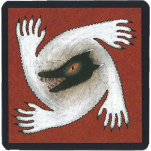

**📖 Chi tiết kỹ năng & Vai trò:**
Sói Trắng là kẻ cô độc đầy dã tâm. Bình thường, Sói Trắng thức dậy chung với bầy Sói và vờ như một đồng minh đáng tin cậy. Tuy nhiên, cứ cách 2 đêm một lần, sau khi bầy Sói đã nhắm mắt, Quản trò sẽ gọi riêng Sói Trắng thức dậy và Sói Trắng có quyền giết chết 1 con Sói khác trong bầy.

**🗣️ Kịch bản Quản trò gọi dậy (GM Call):**
> *"Sau lượt Sói thường (đêm chẵn 2, 4, 6...): 'Sói Trắng thức dậy. Bạn có muốn giết một con Sói khác đêm nay không?' -> Sói Trắng chỉ tay -> Quản trò ghi nhận -> 'Sói Trắng nhắm mắt lại.'"*

**⚠️ Lưu ý quan trọng cho Quản trò:**
- Mục tiêu tối hậu của Sói Trắng là tiêu diệt cả Dân Làng lẫn toàn bộ bầy Sói để trở thành kẻ duy nhất sống sót trong ngôi làng.
- Thuộc Phe Thứ Ba độc lập hoàn toàn.

---

#### 🎴 Ăn Trộm *(Thief)*
- **Phe**: `?` **Tùy Chọn / Biến Đổi**
- **Thứ tự thức dậy ban đêm**: `#0` (Đêm đầu tiên)
- **Tóm tắt hiển thị thẻ bài (Card Badge Text)**: *Đêm đầu tiên thức dậy xem 2 lá bài thừa ngoài bàn cờ và chọn 1 lá để nhận chức năng đó. Nếu có Sói bắt buộc phải chọn Sói.*
- **Hình ảnh lá bài**:
  - Local file: ``
  - Nguồn trực tuyến: ``

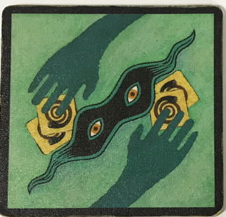

**📖 Chi tiết kỹ năng & Vai trò:**
Khi đưa Ăn Trộm vào bàn chơi, Quản trò sẽ thêm vào 2 lá bài chức năng thừa rồi xáo đều và chia cho mọi người (dư ra 2 lá úp ở giữa bàn). Trong đêm đầu tiên, Ăn Trộm được gọi dậy xem 2 lá bài này và được chọn 1 lá làm vai trò mới của mình cho đến hết ván.

**🗣️ Kịch bản Quản trò gọi dậy (GM Call):**
> *"Quản trò hô: 'Kẻ Ăn Trộm thức dậy. Hãy xem 2 lá bài ở trung tâm và chọn 1 vai trò.' -> Ăn Trộm đổi bài -> 'Ăn Trộm nhắm mắt lại.'"*

**⚠️ Lưu ý quan trọng cho Quản trò:**
- Quy tắc bắt buộc: Nếu trong 2 lá bài úp có ít nhất một lá Ma Sói, Ăn Trộm BẮT BUỘC phải chọn lá Ma Sói đó.
- Nếu Ăn Trộm không đổi vai, người đó tiếp tục chơi như một Dân làng bình thường.

---

### Phần 2: Nhân Vật Trong Ma Sói New Moon (Trăng Non)

#### 🎴 Thằng Ngốc *(Idiot)*
- **Phe**: `V` **Phe Dân Làng**
- **Thứ tự thức dậy ban đêm**: `#95` (Khi bị biểu quyết treo cổ)
- **Tóm tắt hiển thị thẻ bài (Card Badge Text)**: *Nếu bị làng biểu quyết treo cổ, lật bài lên được tha mạng và tiếp tục sống, nhưng mất quyền bỏ phiếu từ đó về sau.*
- **Hình ảnh lá bài**:
  - Local file: ``
  - Nguồn trực tuyến: ``


**📖 Chi tiết kỹ năng & Vai trò:**
Thằng Ngốc là một nhân vật vô tư hài hước của làng. Khi dân làng bỏ phiếu treo cổ Thằng Ngốc, nhân vật này lập tức lật lá bài của mình lên để chứng minh. Cả làng sẽ nhận ra sự vô tội ngốc nghếch của anh ta, tha thứ và không treo cổ nữa.

**🗣️ Kịch bản Quản trò gọi dậy (GM Call):**
> *"Khi Thằng Ngốc bị vote treo cổ: 'Người bị vote là Thằng Ngốc. Làng hủy bỏ án treo cổ, Thằng Ngốc lật bài và mất quyền vote. Làng tiến hành thảo luận và bỏ phiếu lại.'"*

**⚠️ Lưu ý quan trọng cho Quản trò:**
- Sau khi lật bài, Thằng Ngốc vẫn sống và được tham gia thảo luận nhưng MẤT HOÀN TOÀN QUYỀN BIỂU QUYẾT.
- Nếu Thằng Ngốc đang giữ chức Cảnh Sát Trưởng, chức vị này phải lập tức chuyển giao cho người khác.
- Lưu ý: Nếu Thằng Ngốc bị Ma Sói cắn trong đêm hoặc bị Thợ Săn bắn chết thì chết thật bình thường, không được miễn tử.

---

#### 🎴 Già Làng *(Elder)*
- **Phe**: `V` **Phe Dân Làng**
- **Thứ tự thức dậy ban đêm**: `#94` (Thụ động khi bị cắn)
- **Tóm tắt hiển thị thẻ bài (Card Badge Text)**: *Có 2 mạng trước nanh vuốt Sói (phải bị cắn 2 lần mới chết). Nhưng nếu chết vì dân làng, toàn bộ phe Dân mất hết kỹ năng.*
- **Hình ảnh lá bài**:
  - Local file: ``
  - Nguồn trực tuyến: ``

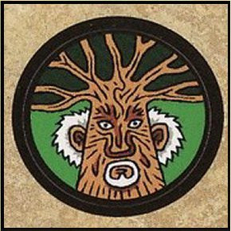

**📖 Chi tiết kỹ năng & Vai trò:**
Già Làng là người có uy tín và sức sống dẻo dai nhất phe Dân Làng. Khi bị Ma Sói cắn lần đầu tiên, Già Làng không chết (mất 1 mạng). Phải bị Sói cắn lần thứ 2 thì Già Làng mới chết thật. Tuy nhiên, dân làng phải hết sức bảo bọc người này.

**🗣️ Kịch bản Quản trò gọi dậy (GM Call):**
> *"Khi Già Làng bị cắn lần đầu: Quản trò thông báo sáng hôm sau không ai chết. Khi Già Làng chết bởi dân làng: Quản trò thông báo toàn bộ dân làng có chức năng bị phong ấn năng lực."*

**⚠️ Lưu ý quan trọng cho Quản trò:**
- Nếu Già Làng bị dân làng treo cổ, bị Thợ Săn bắn chết hoặc bị Phù Thủy dùng bình độc giết, Già Làng chết ngay lập tức.
- HẬU QUẢ NGHIÊM TRỌNG: Nếu Già Làng chết bởi tay phe Dân, toàn bộ các vai trò có chức năng đặc biệt của phe Dân (trừ Thợ Săn) sẽ VĨNH VIỄN MẤT HẾT PHÉP THUẬT, trở thành dân thường!

---

#### 🎴 Người Thế Thân (Kẻ Thế Thân) *(Scapegoat)*
- **Phe**: `V` **Phe Dân Làng**
- **Thứ tự thức dậy ban đêm**: `#93` (Khi bỏ phiếu hòa)
- **Tóm tắt hiển thị thẻ bài (Card Badge Text)**: *Nếu kết quả bỏ phiếu treo cổ của làng bị hòa, Người Thế Thân lập tức bị xử tử thay thế. Khi chết có quyền chỉ định ai được vote ngày mai.*
- **Hình ảnh lá bài**:
  - Local file: ``
  - Nguồn trực tuyến: ``

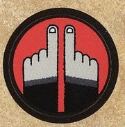

**📖 Chi tiết kỹ năng & Vai trò:**
Người Thế Thân luôn gánh chịu số phận nghiệt ngã. Khi dân làng bỏ phiếu treo cổ mà số phiếu giữa các ứng viên cao nhất bị ngang bằng (hòa phiếu), thay vì không ai chết hay bỏ phiếu lại, Người Thế Thân sẽ lập tức bị đem lên giàn treo thay thế cho tất cả.

**🗣️ Kịch bản Quản trò gọi dậy (GM Call):**
> *"Khi hòa phiếu treo cổ: 'Kết quả bỏ phiếu hòa. Người Thế Thân bị đưa lên giàn treo!' -> 'Trước khi chết, Người Thế Thân hãy chỉ định những người được phép bỏ phiếu vào ngày mai.'"*

**⚠️ Lưu ý quan trọng cho Quản trò:**
- Người Thế Thân phải luôn vận động lập luận để các cuộc biểu quyết không bao giờ rơi vào trạng thái hòa phiếu.
- Quyền năng di ngôn: Khi bị xử tử, người này được quyền chỉ định đích danh những người chơi nào ĐƯỢC hoặc KHÔNG ĐƯỢC biểu quyết vào ngày hôm sau.

---

#### 🎴 Người Thổi Sáo *(Pied Piper)*
- **Phe**: `3` **Phe Thứ 3 (Độc Lập)**
- **Thứ tự thức dậy ban đêm**: `#7` (Mỗi đêm)
- **Tóm tắt hiển thị thẻ bài (Card Badge Text)**: *Mỗi đêm thôi miên 2 người. Những người bị thôi miên nhận diện nhau. Thắng khi toàn bộ người còn sống đều bị thôi miên.*
- **Hình ảnh lá bài**:
  - Local file: ``
  - Nguồn trực tuyến: ``

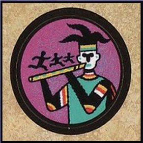

**📖 Chi tiết kỹ năng & Vai trò:**
Người Thổi Sáo là kẻ mang giai điệu mê hoặc bí ẩn. Mỗi đêm, Quản trò gọi Người Thổi Sáo dậy để chọn ra 2 người chơi để thôi miên. Sau đó, Quản trò cho Người Thổi Sáo nhắm mắt lại và gọi toàn bộ những người đã bị thôi miên từ trước đến nay thức dậy nhận diện nhau mà không biết ai là người đã thôi miên họ.

**🗣️ Kịch bản Quản trò gọi dậy (GM Call):**
> *"Quản trò hô: 'Người Thổi Sáo thức dậy. Hãy chọn 2 người để thôi miên đêm nay.' -> Chọn 2 người -> 'Người Thổi Sáo nhắm mắt.' -> 'Tất cả người đã bị thôi miên thức dậy nhận diện nhau.' -> 'Nhắm mắt lại.'"*

**⚠️ Lưu ý quan trọng cho Quản trò:**
- Người Thổi Sáo KHÔNG thể tự thôi miên chính mình.
- Điều kiện thắng duy nhất: Người Thổi Sáo chiến thắng ngay lập tức khi TẤT CẢ người chơi còn sống sót đều đã rơi vào trạng thái bị thôi miên!

---

### Phần 3: Nhân Vật Trong Ma Sói The Village (Ngôi Làng)

#### 🎴 Kẻ Đốt Nhà (Hỏa Hoạn) *(Pyromaniac)*
- **Phe**: `W` **Phe Sói / Phá Hoại**
- **Thứ tự thức dậy ban đêm**: `#8` (Mỗi đêm)
- **Tóm tắt hiển thị thẻ bài (Card Badge Text)**: *Chọn phóng hỏa đốt 1 ngôi nhà. Nếu nhà đó là nơi Sói cắn nạn nhân, con Sói đầu tiên bên phải nhà đó sẽ bị thiêu chết.*
- **Hình ảnh lá bài**:
  - Local file: ``
  - Nguồn trực tuyến: ``

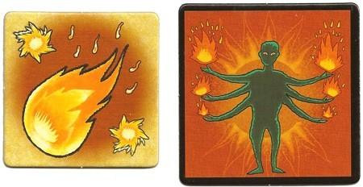

**📖 Chi tiết kỹ năng & Vai trò:**
Kẻ Đốt Nhà sở hữu các thẻ đánh dấu Hỏa hoạn trong bộ The Village. Mỗi đêm, Kẻ Đốt Nhà có thể lựa chọn một ngôi nhà của người chơi để tẩm dầu phóng hỏa. Người mất nhà sẽ trở thành kẻ vô gia cư. Nếu kẻ đốt nhà phóng hỏa đúng vào ngôi nhà mà bầy Sói đang chọn cắn nạn nhân, ngọn lửa bùng lên sẽ thiêu chết con Sói gần nhất bên phải ngôi nhà đó.

**🗣️ Kịch bản Quản trò gọi dậy (GM Call):**
> *"Quản trò hô: 'Kẻ Đốt Nhà thức dậy. Hãy chọn một ngôi nhà để phóng hỏa.' -> Kẻ Đốt Nhà chỉ định ngôi nhà -> Quản trò đặt thẻ Hỏa hoạn."*

**⚠️ Lưu ý quan trọng cho Quản trò:**
- Thẻ Hỏa hoạn là dấu hiệu vật lý đặc trưng của bản The Village.
- Có thể gây sát thương phản đòn bất ngờ lên phe Ma Sói.

---

#### 🎴 Con Quạ (The Village) *(Raven)*
- **Phe**: `V` **Phe Dân Làng**
- **Thứ tự thức dậy ban đêm**: `#9` (Cuối mỗi đêm)
- **Tóm tắt hiển thị thẻ bài (Card Badge Text)**: *Mỗi đêm đặt thẻ 'Chỉ định' trước cửa 1 người chơi. Sáng hôm sau người bị chỉ định mặc định nhận thêm 2 phiếu vote treo cổ.*
- **Hình ảnh lá bài**:
  - Local file: ``
  - Nguồn trực tuyến: ``

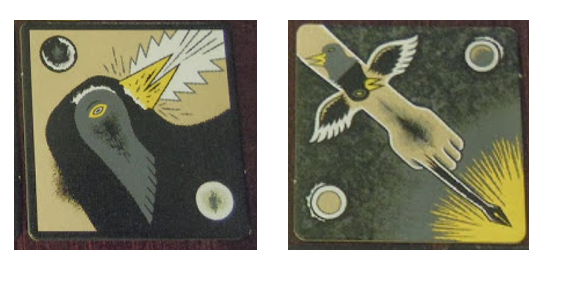

**📖 Chi tiết kỹ năng & Vai trò:**
Vào cuối mỗi đêm, Con Quạ thức dậy và bí mật chỉ điểm 1 người chơi mà mình nghi ngờ nhất. Quản trò sẽ gài thẻ 'Chỉ định' hoặc lông quạ trước cửa nhà người đó. Vào buổi sáng ngày hôm sau, người bị chỉ định sẽ tự động nhận thêm 2 phiếu biểu quyết treo cổ trước khi cả làng bắt đầu bỏ phiếu.

**🗣️ Kịch bản Quản trò gọi dậy (GM Call):**
> *"Quản trò hô: 'Con Quạ thức dậy. Hãy chọn người nhận dấu ấn chỉ định đêm nay.' -> Quản trò đặt thẻ Chỉ định trước mặt người bị chọn."*

**⚠️ Lưu ý quan trọng cho Quản trò:**
- Rất có lợi để dồn phiếu diệt Sói khi phe Dân làng cần định hướng dư luận.
- Cần tránh để Sói biết Con Quạ là ai.

---

### Phần 4: Nhân Vật Trong Ma Sói Characters

#### 🎴 Dân Thường (Characters) *(Simple Villager Variant)*
- **Phe**: `V` **Phe Dân Làng**
- **Thứ tự thức dậy ban đêm**: `#99` (Không thức dậy)
- **Tóm tắt hiển thị thẻ bài (Card Badge Text)**: *Lá bài Dân làng phiên bản tạo hình nghệ thuật của bộ Characters.*
- **Hình ảnh lá bài**:
  - Local file: ``
  - Nguồn trực tuyến: ``

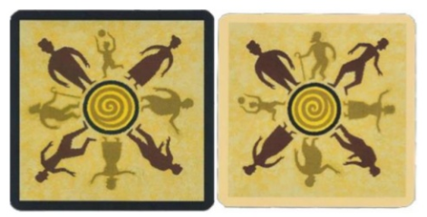

**📖 Chi tiết kỹ năng & Vai trò:**
Dân thường trung kiên của ngôi làng. Ban đêm đi ngủ ngoan ngoãn, ban ngày thức dậy cùng mọi người truy tìm tung tích bầy Sói gian ác.

**🗣️ Kịch bản Quản trò gọi dậy (GM Call):**
> *"Không gọi thức dậy vào ban đêm."*

**⚠️ Lưu ý quan trọng cho Quản trò:**
- Tham gia thảo luận và vote bình thường.

---

#### 🎴 Hai Chị Em *(Two Sisters)*
- **Phe**: `V` **Phe Dân Làng**
- **Thứ tự thức dậy ban đêm**: `#2` (Mỗi đêm (hoặc đêm đầu))
- **Tóm tắt hiển thị thẻ bài (Card Badge Text)**: *Hai người chơi giữ thẻ Hai Chị Em thức dậy nhận diện nhau vào ban đêm, cùng phối hợp biểu quyết vào ban ngày.*
- **Hình ảnh lá bài**:
  - Local file: ``
  - Nguồn trực tuyến: ``

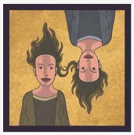

**📖 Chi tiết kỹ năng & Vai trò:**
Gồm 2 lá bài dành cho 2 người chơi. Trong đêm đầu tiên (hoặc mỗi đêm tùy luật làng), Quản trò cho Hai Chị Em thức dậy nhìn mặt nhau. Họ biết chắc chắn người kia là Dân Làng đồng minh đáng tin cậy 100% để cùng nhau liên minh tranh luận và dồn phiếu.

**🗣️ Kịch bản Quản trò gọi dậy (GM Call):**
> *"Quản trò hô: 'Hai Chị Em thức dậy nhận diện nhau.' -> Nhìn mặt nhau -> 'Hai Chị Em nhắm mắt lại.'"*

**⚠️ Lưu ý quan trọng cho Quản trò:**
- Tạo thành một cặp đồng minh vững chắc không sợ bị phản bội.

---

#### 🎴 Ba Anh Em *(Three Brothers)*
- **Phe**: `V` **Phe Dân Làng**
- **Thứ tự thức dậy ban đêm**: `#2.1` (Đêm đầu tiên)
- **Tóm tắt hiển thị thẻ bài (Card Badge Text)**: *Ba người chơi giữ lá Ba Anh Em thức dậy nhận diện nhau vào ban đêm, tạo thành liên minh 3 phiếu tin cậy tuyệt đối.*
- **Hình ảnh lá bài**:
  - Local file: ``
  - Nguồn trực tuyến: ``


**📖 Chi tiết kỹ năng & Vai trò:**
Tương tự như Hai Chị Em nhưng gồm 3 lá bài. Ba anh em thức dậy cùng nhau vào đêm đầu tiên để biết mặt nhau. Với 3 phiếu biểu quyết đoàn kết từ phe Dân, họ có thể chi phối mạnh mẽ các lượt treo cổ ban ngày.

**🗣️ Kịch bản Quản trò gọi dậy (GM Call):**
> *"Quản trò hô: 'Ba Anh Em thức dậy nhìn mặt nhau.' -> Nhận diện -> 'Ba Anh Em nhắm mắt lại.'"*

**⚠️ Lưu ý quan trọng cho Quản trò:**
- Tạo ưu thế số đông cho phe Dân Làng ở giai đoạn đầu game.

---

#### 🎴 Thiên Sứ *(Angel)*
- **Phe**: `3` **Phe Thứ 3 (Độc Lập)**
- **Thứ tự thức dậy ban đêm**: `#92` (Ngày đầu tiên)
- **Tóm tắt hiển thị thẻ bài (Card Badge Text)**: *Mục tiêu là tự làm cho bản thân bị dân làng treo cổ ngay trong ngày biểu quyết đầu tiên. Nếu làm được, thắng game ngay!*
- **Hình ảnh lá bài**:
  - Local file: ``
  - Nguồn trực tuyến: ``

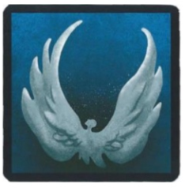

**📖 Chi tiết kỹ năng & Vai trò:**
Thiên Sứ là một nhân vật độc đáo có điều kiện thắng thần tốc. Mục tiêu của Thiên Sứ là dụ dỗ, khiêu khích hoặc diễn xuất sao cho làng biểu quyết treo cổ chính mình ngay trong ngày đầu tiên của ván chơi.

**🗣️ Kịch bản Quản trò gọi dậy (GM Call):**
> *"Nếu Thiên Sứ bị treo cổ trong ngày 1: Quản trò tuyên bố Thiên Sứ chiến thắng solo ván đấu!"*

**⚠️ Lưu ý quan trọng cho Quản trò:**
- Nếu bị treo cổ ngày đầu tiên: THIÊN SỨ THẮNG TRÒ CHƠI NGAY LẬP TỨC.
- Nếu ngày đầu tiên không bị treo cổ, Thiên Sứ mất hết điều kiện thắng đặc biệt và trở thành một Dân thường bình thường.

---

#### 🎴 Thẩm Phán Lắp Bắp *(Stuttering Judge)*
- **Phe**: `V` **Phe Dân Làng**
- **Thứ tự thức dậy ban đêm**: `#91` (Đêm 1 ra ám hiệu)
- **Tóm tắt hiển thị thẻ bài (Card Badge Text)**: *Trong đêm đầu tiên thống nhất 1 ám hiệu với Quản trò. Ban ngày được kích hoạt ám hiệu 1 lần để mở cuộc vote treo cổ thứ 2.*
- **Hình ảnh lá bài**:
  - Local file: ``
  - Nguồn trực tuyến: ``

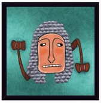

**📖 Chi tiết kỹ năng & Vai trò:**
Đêm đầu tiên, Thẩm Phán Lắp Bắp thức dậy và làm một ký hiệu bí mật với Quản trò (ví dụ: gãi tai, chớp mắt hai lần, vỗ tay...). Một lần duy nhất trong toàn bộ ván đấu, ngay sau khi một người vừa bị biểu quyết treo cổ xong, Thẩm Phán có thể làm lại dấu hiệu này để Quản trò lập tức tuyên bố mở cuộc thảo luận và biểu quyết treo cổ NGƯỜI THỨ HAI trong cùng ngày.

**🗣️ Kịch bản Quản trò gọi dậy (GM Call):**
> *"Đêm 1: 'Thẩm Phán Lắp Bắp thức dậy và làm dấu bí mật với Quản trò.' Ban ngày khi thấy dấu: 'Thẩm phán đã ra phán quyết! Làng tiếp tục tiến hành vòng vote thứ hai!'"*

**⚠️ Lưu ý quan trọng cho Quản trò:**
- Rất lợi hại khi làng đang nắm chắc tung tích của nhiều con Sói cùng lúc.

---

#### 🎴 Hiệp Sĩ Kiếm Gỉ *(Knight with the Rusty Sword)*
- **Phe**: `V` **Phe Dân Làng**
- **Thứ tự thức dậy ban đêm**: `#90` (Thụ động khi bị Sói cắn)
- **Tóm tắt hiển thị thẻ bài (Card Badge Text)**: *Nếu bị Sói cắn chết, thanh kiếm rỉ sét sẽ làm nhiễm trùng con Sói cắn mình. Con Sói đó sẽ chết vào sáng ngày hôm sau nữa.*
- **Hình ảnh lá bài**:
  - Local file: ``
  - Nguồn trực tuyến: ``

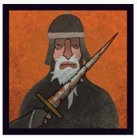

**📖 Chi tiết kỹ năng & Vai trò:**
Hiệp sĩ mang thanh kiếm rỉ sét độc hại. Khi bị Ma Sói tấn công và cắn chết trong đêm, lưỡi kiếm rỉ sét sẽ đâm bị thương con Sói đầu tiên bên tay trái nạn nhân (hoặc con Sói cắn). Con Sói bị thương này chỉ sống thêm được đúng 1 ngày 1 đêm rồi sẽ chết gục vì uốn ván/nhiễm độc.

**🗣️ Kịch bản Quản trò gọi dậy (GM Call):**
> *"Khi Hiệp Sĩ chết bởi Sói: Quản trò bí mật ghi nhận con Sói bên trái bị trúng độc và công bố con Sói đó chết vào sáng ngày hôm sau nữa."*

**⚠️ Lưu ý quan trọng cho Quản trò:**
- Giúp đổi mạng 1 lấy 1 với phe Sói mà không cần dùng súng như Thợ Săn.

---

#### 🎴 Cáo *(Fox)*
- **Phe**: `V` **Phe Dân Làng**
- **Thứ tự thức dậy ban đêm**: `#4.1` (Mỗi đêm)
- **Tóm tắt hiển thị thẻ bài (Card Badge Text)**: *Mỗi đêm chọn nhóm 3 người chơi ngồi liền kề. Nếu có ít nhất 1 Sói thì Quản trò gật đầu và Cáo giữ năng lực. Nếu không có Sói, Cáo mất phép vĩnh viễn.*
- **Hình ảnh lá bài**:
  - Local file: ``
  - Nguồn trực tuyến: ``

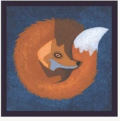

**📖 Chi tiết kỹ năng & Vai trò:**
Hằng đêm, Cáo thức dậy và chỉ vào một người chơi (người này cùng với 2 người ngồi sát 2 bên tạo thành nhóm 3 người). Quản trò kiểm tra xem trong nhóm 3 người đó có ít nhất một con Sói hay không. Nếu CÓ SÓI, Quản trò gật đầu, Cáo biết có sói lẩn khuất trong nhóm và GIỮ NGUYÊN NĂNG LỰC cho các đêm sau. Nếu HOÀN TOÀN KHÔNG CÓ SÓI, Quản trò lắc đầu và Cáo MẤT HOÀN TOÀN PHÉP THUẬT từ đêm đó.

**🗣️ Kịch bản Quản trò gọi dậy (GM Call):**
> *"Quản trò hô: 'Cáo thức dậy. Hãy chọn một mục tiêu kiểm tra.' -> Cáo chỉ 1 người (tính cả 2 người kế bên) -> Quản trò ra dấu Có/Không Sói -> 'Cáo nhắm mắt lại.'"*

**⚠️ Lưu ý quan trọng cho Quản trò:**
- Là trinh sát diện rộng cực kỳ đắc lực cho phe Dân Làng.

---

#### 🎴 Người Thuần Phục Gấu *(Bear Tamer)*
- **Phe**: `V` **Phe Dân Làng**
- **Thứ tự thức dậy ban đêm**: `#89` (Đầu mỗi buổi sáng)
- **Tóm tắt hiển thị thẻ bài (Card Badge Text)**: *Vào đầu buổi sáng, nếu 1 trong 2 người ngồi sát bên cạnh là Ma Sói, chú gấu sẽ gầm lên (Quản trò gầm 'Gừ...').*
- **Hình ảnh lá bài**:
  - Local file: ``
  - Nguồn trực tuyến: ``

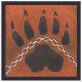

**📖 Chi tiết kỹ năng & Vai trò:**
Người Thuần Phục Gấu có một chú gấu linh cảm rất nhạy với mùi của Ma Sói. Vào mỗi buổi sáng khi cả làng thức dậy, nếu một trong hai người chơi ngồi ngay cạnh bên trái hoặc bên phải của Người Thuần Phục Gấu là Ma Sói (hoặc nếu chính bản thân anh ta bị biến thành Sói), Quản trò sẽ phát ra tiếng gầm 'Gừ gừ!' để báo động.

**🗣️ Kịch bản Quản trò gọi dậy (GM Call):**
> *"Mỗi sáng: Quản trò kiểm tra 2 người ngồi cạnh Bear Tamer. Nếu có Sói -> Quản trò phát ra âm thanh tiếng Gấu gầm gừ."*

**⚠️ Lưu ý quan trọng cho Quản trò:**
- Nếu cả hai người bên cạnh đều là Dân lương thiện, Quản trò không gầm gì cả.
- Làng sẽ biết ngay có Sói ngồi gần Người Thuần Phục Gấu.

---

#### 🎴 Diễn Viên *(Actor)*
- **Phe**: `?` **Tùy Chọn / Biến Đổi**
- **Thứ tự thức dậy ban đêm**: `#0.5` (Trong 3 đêm đầu)
- **Tóm tắt hiển thị thẻ bài (Card Badge Text)**: *Để 3 lá bài thừa ngoài cuộc. Trong 3 đêm đầu, Diễn Viên có thể chọn tráo thẻ của mình lấy 1 trong 3 lá này. Sau đêm 3 thành Dân thường.*
- **Hình ảnh lá bài**:
  - Local file: ``
  - Nguồn trực tuyến: ``

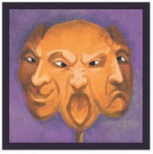

**📖 Chi tiết kỹ năng & Vai trò:**
Khi có Diễn Viên trong ván, Quản trò để 3 lá bài nhân vật thừa nằm úp ở ngoài. Trong 3 đêm đầu tiên, mỗi đêm Diễn Viên có quyền thức dậy xem và chọn tráo đổi lá bài của mình lấy 1 trong 3 lá đó để nhận chức năng của lá mới. Sau đêm thứ 3, nếu không chọn, Diễn Viên sẽ chơi như Dân thường.

**🗣️ Kịch bản Quản trò gọi dậy (GM Call):**
> *"Đêm 1, 2, 3: 'Diễn Viên thức dậy. Bạn có muốn đổi vai diễn mới không?' -> Diễn viên chọn hoặc bỏ qua -> 'Nhắm mắt lại.'"*

**⚠️ Lưu ý quan trọng cho Quản trò:**
- Tạo ra sự biến hóa khôn lường khó đoán trong chiến thuật.

---

#### 🎴 Người Đầy Tớ Tận Tụy *(Devoted Servant)*
- **Phe**: `V` **Biến Đổi / Thừa Kế**
- **Thứ tự thức dậy ban đêm**: `#88` (Khi có người bị treo cổ)
- **Tóm tắt hiển thị thẻ bài (Card Badge Text)**: *Bất cứ lúc nào khi có 1 người bị làng biểu quyết treo cổ, Người Hầu có thể lật bài đổi thẻ lấy nhân vật của người vừa chết để tiếp tục chơi.*
- **Hình ảnh lá bài**:
  - Local file: ``
  - Nguồn trực tuyến: ``

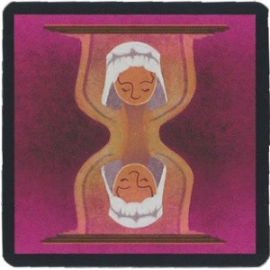

**📖 Chi tiết kỹ năng & Vai trò:**
Người Đầy Tớ Tận Tụy là kẻ luôn trung thành tìm kiếm một vị chủ nhân mới. Bất cứ lúc nào trong ván chơi, ngay khi một người chơi vừa bị biểu quyết treo cổ, Người Đầy Tớ có thể công khai lật lá bài của mình lên và lấy lại lá bài của người vừa chết để đóng vai nhân vật đó cho đến hết ván.

**🗣️ Kịch bản Quản trò gọi dậy (GM Call):**
> *"Khi nạn nhân bị treo cổ: Người Đầy Tớ tuyên bố đổi thẻ -> Quản trò thu thẻ Người Đầy Tớ và trao thẻ nạn nhân cho người này."*

**⚠️ Lưu ý quan trọng cho Quản trò:**
- Nếu nạn nhân là Sói, Người Đầy Tớ lập tức trở thành Sói!
- Nếu nạn nhân là Tiên Tri/Bảo Vệ, Người Đầy Tớ kế thừa năng lực đó.

---

#### 🎴 Thành Viên Giáo Phái *(Cult Leader)*
- **Phe**: `3` **Phe Thứ 3 (Độc Lập)**
- **Thứ tự thức dậy ban đêm**: `#87` (Trước ván chia phe)
- **Tóm tắt hiển thị thẻ bài (Card Badge Text)**: *Quản trò chia cả làng làm 2 phái (theo kính/không kính, nam/nữ...). Hắn thuộc 1 phe và thắng khi toàn bộ phe đối địch bị loại sạch.*
- **Hình ảnh lá bài**:
  - Local file: ``
  - Nguồn trực tuyến: ``

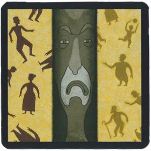

**📖 Chi tiết kỹ năng & Vai trò:**
Trước khi ván chơi bắt đầu, Quản trò chia cả làng thành 2 phe phái rõ ràng dựa trên một đặc điểm ngoại hình hiển nhiên (ví dụ: người có đeo kính vs người không đeo kính; nam vs nữ; áo sáng màu vs áo tối màu). Thành viên giáo phái thuộc 1 trong 2 nhóm đó. Hắn không có phép thuật thần bí nào ngoài tài dẫn dắt dư luận loại bỏ toàn bộ người của phe đối địch.

**🗣️ Kịch bản Quản trò gọi dậy (GM Call):**
> *"Đầu ván: Quản trò công bố tiêu chí phân chia 2 giáo phái cho cả làng biết."*

**⚠️ Lưu ý quan trọng cho Quản trò:**
- Điều kiện thắng: Khi tất cả thành viên của phe đối nghịch đều đã bị tiêu diệt.

---

#### 🎴 Đứa Trẻ Hoang Dã *(Wild Child)*
- **Phe**: `?` **Biến Đổi (Phe Dân -> Phe Sói)**
- **Thứ tự thức dậy ban đêm**: `#1.5` (Đêm 1 chọn thần tượng)
- **Tóm tắt hiển thị thẻ bài (Card Badge Text)**: *Đêm đầu tiên chọn 1 người chơi làm Thần Tượng. Nếu Thần Tượng chết trong ván chơi, Đứa Trẻ lập tức hóa thành Ma Sói.*
- **Hình ảnh lá bài**:
  - Local file: ``
  - Nguồn trực tuyến: ``

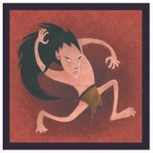

**📖 Chi tiết kỹ năng & Vai trò:**
Đứa Trẻ Hoang Dã ban đầu thuộc phe Dân Làng. Trong đêm đầu tiên, em thức dậy và chọn 1 người chơi làm 'Thần Tượng / Người giám hộ' của mình. Nếu trong quá trình chơi, người Thần Tượng này bị chết (vì bất kỳ lý do gì), Đứa Trẻ Hoang Dã sẽ phẫn nộ biến thành Ma Sói và từ đêm tiếp theo sẽ thức dậy cùng bầy Sói.

**🗣️ Kịch bản Quản trò gọi dậy (GM Call):**
> *"Đêm 1: 'Đứa Trẻ Hoang Dã thức dậy. Hãy chọn Thần Tượng của bạn.' -> Quản trò ghi nhớ. Khi Thần tượng chết: Quản trò bí mật chạm vai Đứa Trẻ báo hiệu đã hóa Sói."*

**⚠️ Lưu ý quan trọng cho Quản trò:**
- Chừng nào Thần Tượng còn sống, Đứa Trẻ vẫn là Dân Làng.
- Khi Thần Tượng chết, Đứa Trẻ chính thức trở thành Ma Sói và cùng phe Sói săn mồi.

---

#### 🎴 Chó Sói / Bán Sói / Sói Lai *(Wolf Hound)*
- **Phe**: `?` **Tự Chọn (Dân hoặc Sói)**
- **Thứ tự thức dậy ban đêm**: `#0.8` (Đêm đầu tiên)
- **Tóm tắt hiển thị thẻ bài (Card Badge Text)**: *Vào đêm đầu tiên, được tự ý lựa chọn muốn trở thành Dân Làng lương thiện hay gia nhập phe Ma Sói tàn bạo.*
- **Hình ảnh lá bài**:
  - Local file: ``
  - Nguồn trực tuyến: ``

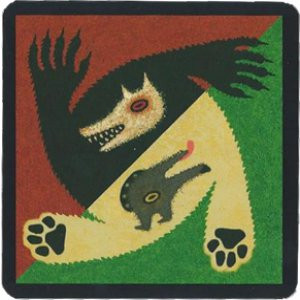

**📖 Chi tiết kỹ năng & Vai trò:**
Chó Sói đứng giữa lằn ranh của thú tính và nhân tính. Đêm đầu tiên, Quản trò gọi Chó Sói dậy và cho phép người chơi này đưa ra quyết định tối thượng: muốn sống cuộc đời một Dân làng lương thiện hay muốn thức tỉnh bản năng Ma Sói. Nếu chọn Sói, người đó sẽ thức dậy cùng bầy Sói ngay từ đêm đó.

**🗣️ Kịch bản Quản trò gọi dậy (GM Call):**
> *"Đêm 1: 'Chó Sói thức dậy. Bạn chọn làm Dân hay Sói?' -> Người chơi ra dấu hiệu -> Quản trò ghi nhận."*

**⚠️ Lưu ý quan trọng cho Quản trò:**
- Quyết định này là vĩnh viễn và không thể thay đổi trong suốt phần còn lại của ván đấu.

---

#### 🎴 Sói Lớn Xấu Xa *(Big Bad Wolf)*
- **Phe**: `W` **Phe Sói**
- **Thứ tự thức dậy ban đêm**: `#5.1` (Mỗi đêm)
- **Tóm tắt hiển thị thẻ bài (Card Badge Text)**: *Thuộc phe Sói. Cho đến khi chưa có bất kỳ con Sói nào (kể cả Sói lai, Sói con) chết, Sói Lớn được thức dậy cắn thêm 1 người nữa mỗi đêm.*
- **Hình ảnh lá bài**:
  - Local file: ``
  - Nguồn trực tuyến: ``

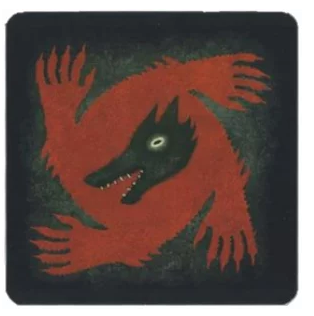

**📖 Chi tiết kỹ năng & Vai trò:**
Sói Lớn Xấu Xa là bạo chúa của đàn Sói. Hằng đêm thức dậy cùng bầy Sói và cắn nạn nhân chung. ĐẶC BIỆT: Chừng nào chưa có bất kỳ thành viên nào thuộc họ Sói bị chết (Sói thường, Sói con, Đứa trẻ hoang dã hóa sói, Chó sói), sau khi bầy Sói ngủ, Sói Lớn được Quản trò gọi dậy RIÊNG MỘT LẦN NỮA để tự tay cắn chết thêm 1 dân làng khác!

**🗣️ Kịch bản Quản trò gọi dậy (GM Call):**
> *"Sau lượt Sói chung: 'Sói Lớn Xấu Xa thức dậy độc lập. Hãy chọn nạn nhân thứ hai đêm nay.' -> Chỉ định nạn nhân -> 'Nhắm mắt lại.'"*

**⚠️ Lưu ý quan trọng cho Quản trò:**
- Giúp phe Sói có tốc độ tàn sát gấp đôi ở giai đoạn đầu game.
- Khi có ít nhất 1 con Sói phe mình ngã xuống, Sói Lớn mất năng lực cắn thêm này.

---

#### 🎴 Người Cha Của Sói (Sói Đầu Đàn) *(Father of Wolves)*
- **Phe**: `W` **Phe Sói**
- **Thứ tự thức dậy ban đêm**: `#5.2` (Mỗi đêm)
- **Tóm tắt hiển thị thẻ bài (Card Badge Text)**: *Thuộc phe Sói. Một lần duy nhất trong ván, sau khi Sói cắn người, có thể lây nhiễm biến nạn nhân đó thành Ma Sói thay vì chết.*
- **Hình ảnh lá bài**:
  - Local file: ``
  - Nguồn trực tuyến: ``

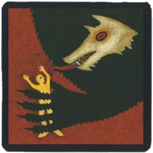

**📖 Chi tiết kỹ năng & Vai trò:**
Người Cha Của Sói là thủ lĩnh cổ xưa của loài Sói. Thức dậy cùng đàn Sói mỗi đêm. Một lần duy nhất trong ván, ngay sau khi bầy Sói đã cắn 1 người, Người Cha có thể giơ tay ra hiệu cho Quản trò để 'Truyền nọc độc' biến nạn nhân đó thành một Ma Sói mới vào đêm sau, thay vì để nạn nhân phải chết vào sáng mai.

**🗣️ Kịch bản Quản trò gọi dậy (GM Call):**
> *"Khi Sói vừa chọn nạn nhân: 'Người Cha Của Sói có muốn lây nhiễm đồng hóa nạn nhân này không?' -> Cha của Sói gật/lắc đầu."*

**⚠️ Lưu ý quan trọng cho Quản trò:**
- Nạn nhân được lây nhiễm sẽ không chết sáng hôm sau, và từ đêm tiếp theo sẽ thức dậy cùng phe Sói.
- Gia tăng quân số đắc lực cho phe Sói.

---

#### 🎴 Bà Đồng *(Village Soothsayer)*
- **Phe**: `V` **Phe Dân Làng**
- **Thứ tự thức dậy ban đêm**: `#3.5` (5 lần trong ván)
- **Tóm tắt hiển thị thẻ bài (Card Badge Text)**: *Có tối đa 5 lần gọi hồn trong ván. Quản trò đọc 4 câu hỏi từ lá Gọi Hồn, Bà Đồng chọn 1 câu và chỉ 1 người trả lời vào sáng mai.*
- **Hình ảnh lá bài**:
  - Local file: ``
  - Nguồn trực tuyến: ``

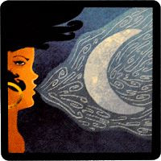

**📖 Chi tiết kỹ năng & Vai trò:**
Đầu ván, Quản trò chọn ra 5 lá Gọi Hồn (Spiritualism card) và giữ bí mật. Trong tối đa 5 đêm của ván chơi, Quản trò gọi Bà Đồng dậy và hỏi mụ có muốn sử dụng linh năng không. Nếu có, Quản trò đọc nhỏ 4 câu hỏi từ 1 lá bài Gọi Hồn. Bà Đồng ra dấu chọn 1 câu hỏi và chỉ định 1 người chơi. Sáng hôm sau, người chơi được chỉ định phải trả lời thật lòng câu hỏi đó trước cả làng.

**🗣️ Kịch bản Quản trò gọi dậy (GM Call):**
> *"Quản trò hô: 'Bà Đồng thức dậy. Bạn có muốn sử dụng linh cảm đêm nay không?' -> Bà đồng chọn câu hỏi và người trả lời -> 'Bà Đồng nhắm mắt lại.'"*

**⚠️ Lưu ý quan trọng cho Quản trò:**
- Thay thế sự kiện thường của làng bằng phiên giải đáp tâm linh bí ẩn.
- Tối đa chỉ dùng được 5 lần trong một ván chơi.

---

#### 🎴 Cảnh Sát *(Sheriff's Deputy / Policeman)*
- **Phe**: `V` **Chức vị phong thêm**
- **Thứ tự thức dậy ban đêm**: `#86` (Mỗi buổi sáng)
- **Tóm tắt hiển thị thẻ bài (Card Badge Text)**: *Do Cảnh Sát Trưởng bổ nhiệm. Phụ trách bốc và đọc to các lá bài Sự Kiện của làng mỗi buổi sáng trước khi vote.*
- **Hình ảnh lá bài**:
  - Local file: ``
  - Nguồn trực tuyến: ``

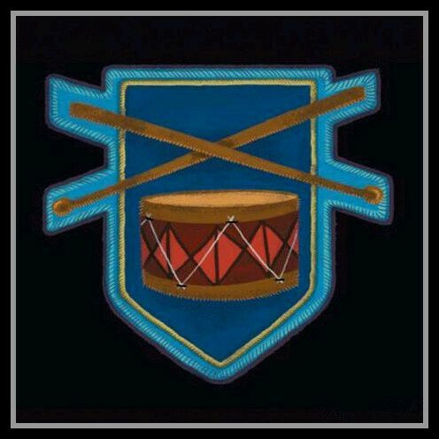

**📖 Chi tiết kỹ năng & Vai trò:**
Cảnh Sát là chức vụ hỗ trợ đặc biệt được Cảnh Sát Trưởng phong thêm cho 1 người chơi ngoài lá nhân vật sẵn có (Cảnh Sát Trưởng không thể tự phong cho chính mình). Trước ván, Quản trò chuẩn bị một số lá Sự Kiện (Event cards). Mỗi sáng sau khi công bố người chết, Quản trò hỏi Cảnh Sát có thông báo gì không, Cảnh Sát sẽ chọn và đọc lớn một lá Sự Kiện làm luật áp dụng cho ngày hôm đó.

**🗣️ Kịch bản Quản trò gọi dậy (GM Call):**
> *"Mỗi sáng: 'Mời Cảnh Sát đọc bản tin Sự Kiện hôm nay.' Cảnh Sát Trưởng có thể bãi chức Cảnh Sát bất cứ lúc nào trước giờ bỏ phiếu."*

**⚠️ Lưu ý quan trọng cho Quản trò:**
- Khác với Cảnh Sát Trưởng (trưởng làng 2 phiếu vote), Cảnh Sát chuyên trách điều hành Sự Kiện.
- Cảnh Sát Trưởng có thể tước chức và chuyển cho người khác trước giờ biểu quyết.

---

### Phần 5: Nhân Vật Trong Ma Sói Character Plus

#### 🎴 Nguyệt Nữ *(Moon Maiden)*
- **Phe**: `V` **Phe Dân Làng**
- **Thứ tự thức dậy ban đêm**: `#0.2` (Đầu mỗi đêm)
- **Tóm tắt hiển thị thẻ bài (Card Badge Text)**: *Đầu mỗi đêm thức dậy chọn 1 người để phong ấn, người đó sẽ bị vô hiệu hóa toàn bộ kỹ năng trong suốt đêm đó.*
- **Hình ảnh lá bài**:
  - Local file: ``
  - Nguồn trực tuyến: ``


**📖 Chi tiết kỹ năng & Vai trò:**
Mỗi đêm, Nguyệt Nữ thức dậy đầu tiên dưới ánh trăng và chỉ định 1 người chơi. Người chơi bị chọn sẽ bị khóa phép thuật và vô hiệu hóa hoàn toàn năng lực trong suốt đêm đó (ví dụ: Tiên Tri bị chọn sẽ không soi được, Phù Thủy không dùng được bình thuốc...).

**🗣️ Kịch bản Quản trò gọi dậy (GM Call):**
> *"Quản trò hô: 'Nguyệt Nữ thức dậy. Hãy chọn người bạn muốn phong ấn đêm nay.' -> Nguyệt Nữ chỉ tay -> Quản trò ghi nhận -> 'Nguyệt Nữ nhắm mắt lại.'"*

**⚠️ Lưu ý quan trọng cho Quản trò:**
- Ngoại lệ: Nguyệt Nữ KHÔNG vô hiệu hóa được chức năng của Bảo Vệ.
- Không ảnh hưởng đến các kỹ năng chỉ áp dụng vào ban ngày.

---

#### 🎴 Thầy Thôi Miên *(Hypnotist)*
- **Phe**: `V` **Phe Dân Làng**
- **Thứ tự thức dậy ban đêm**: `#3.2` (Mỗi đêm)
- **Tóm tắt hiển thị thẻ bài (Card Badge Text)**: *Mỗi đêm mê hoặc 1 người. Nếu đêm đó Thầy Thôi Miên bị chết, người bị mê hoặc sẽ chết thay thế! Không chọn 1 người 2 đêm liền.*
- **Hình ảnh lá bài**:
  - Local file: ``
  - Nguồn trực tuyến: ``

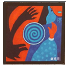

**📖 Chi tiết kỹ năng & Vai trò:**
Hằng đêm, Thầy Thôi Miên tỉnh dậy và chọn 1 người chơi để giăng bùa mê hoặc. Tác dụng thế mạng: Nếu trong đêm đó Thầy Thôi Miên bị Sói cắn chết, phép thuật sẽ chuyển hướng đòn tấn công khiến người bị mê hoặc phải chết thay cho Thầy Thôi Miên!

**🗣️ Kịch bản Quản trò gọi dậy (GM Call):**
> *"Quản trò hô: 'Thầy Thôi Miên thức dậy. Hãy chọn người bạn muốn mê hoặc đêm nay.' -> Thầy chỉ định mục tiêu -> 'Thầy Thôi Miên nhắm mắt lại.'"*

**⚠️ Lưu ý quan trọng cho Quản trò:**
- Thầy Thôi Miên KHÔNG được phép chọn liên tục cùng 1 người trong 2 đêm liên tiếp.
- Là lớp lá chắn sống cực kỳ an toàn để giữ mạng.

---

#### 🎴 Dược Sĩ *(Apothecary / Pharmacist)*
- **Phe**: `V` **Phe Dân Làng**
- **Thứ tự thức dậy ban đêm**: `#6.5` (Mỗi đêm)
- **Tóm tắt hiển thị thẻ bài (Card Badge Text)**: *Có 2 bình dùng 1 lần: Bình Thuốc Mê (cấm 1 người nói và cấm vote trong ngày) và Bình Hồi Phục (cứu người bị Phù Thủy giết).*
- **Hình ảnh lá bài**:
  - Local file: ``
  - Nguồn trực tuyến: ``


**📖 Chi tiết kỹ năng & Vai trò:**
Dược Sĩ sở hữu 2 bình thuốc đặc chế độc nhất vô nhị: Bình Thuốc Mê và Bình Hồi Phục. Mỗi đêm Dược Sĩ thức dậy để quyết định có sử dụng bình nào không. Mỗi bình chỉ được sử dụng duy nhất một lần trong cả ván.

**🗣️ Kịch bản Quản trò gọi dậy (GM Call):**
> *"Quản trò hô: 'Dược Sĩ thức dậy. Bạn có muốn dùng Bình Thuốc Mê (câm lặng + cấm vote) hay Bình Hồi Phục (cứu độc Phù Thủy) không?'"*

**⚠️ Lưu ý quan trọng cho Quản trò:**
- Bình Thuốc Mê: Làm cho 1 người chơi bị cấm nói chuyện và mất hoàn toàn quyền biểu quyết trong 1 ngày.
- Bình Hồi Phục: Nếu chọn đúng người bị Phù Thủy hạ độc giết chết trong đêm thì nạn nhân sẽ được giải độc và sống sót bình thường.

---

#### 🎴 Người Múa Rối *(Puppeteer)*
- **Phe**: `V` **Phe Dân / Phe Sói (Tùy bản)**
- **Thứ tự thức dậy ban đêm**: `#4.9` (1 lần trong ván)
- **Tóm tắt hiển thị thẻ bài (Card Badge Text)**: *Một lần duy nhất trong cả ván chơi, có quyền ép bầy Sói phải ăn thịt 1 người do mình chỉ định (kể cả ép Sói tự ăn thịt một con Sói khác).*
- **Hình ảnh lá bài**:
  - Local file: ``
  - Nguồn trực tuyến: ``

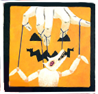

**📖 Chi tiết kỹ năng & Vai trò:**
Người Múa Rối nắm giữ những sợi tơ điều khiển tâm trí ma quái. Một lần duy nhất trong toàn bộ ván chơi, Người Múa Rối có thể can thiệp buộc bầy Ma Sói phải cắn chết một nạn nhân do chính Người Múa Rối chỉ định, thay thế cho sự thống nhất ban đầu của bầy Sói. Người Múa Rối thậm chí có thể ép đàn Sói tự cắn chết một con Sói khác trong bầy!

**🗣️ Kịch bản Quản trò gọi dậy (GM Call):**
> *"Trong lượt Sói: Nếu Người Múa Rối kích hoạt quyền năng, Quản trò bắt bầy Sói phải đổi mục tiêu theo lệnh Người Múa Rối."*

**⚠️ Lưu ý quan trọng cho Quản trò:**
- Năng lực xoay chuyển cục diện ván cờ cực kỳ kinh hoàng.

---

#### 🎴 Sát Thủ (Thích Khách) *(Assassin)*
- **Phe**: `3` **Phe Độc Lập / Phục Thù**
- **Thứ tự thức dậy ban đêm**: `#7.5` (Mỗi 2 đêm khi đủ 4 phiếu)
- **Tóm tắt hiển thị thẻ bài (Card Badge Text)**: *Mỗi 2 đêm, nếu số phiếu biểu quyết vào Sát Thủ trong các ngày qua đạt mốc 4 phiếu, Sát Thủ thức dậy ám sát 1 người ngay lập tức.*
- **Hình ảnh lá bài**:
  - Local file: ``
  - Nguồn trực tuyến: ``

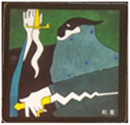

**📖 Chi tiết kỹ năng & Vai trò:**
Sát Thủ là kẻ ẩn mình trong bóng tối tích tụ sự nghi kỵ. Mỗi 2 đêm, Quản trò kiểm tra số phiếu tích lũy mà dân làng đã từng vote vào Sát Thủ. Nếu tổng số phiếu chỉ vào Sát Thủ đạt từ 4 phiếu trở lên, Sát Thủ sẽ được quyền thức dậy chỉ định giết chết 1 người chơi bất kỳ.

**🗣️ Kịch bản Quản trò gọi dậy (GM Call):**
> *"Đêm đủ điều kiện: 'Sát Thủ thức dậy. Hãy chỉ định mục tiêu bị ám sát đêm nay.' -> Quản trò ghi nhận."*

**⚠️ Lưu ý quan trọng cho Quản trò:**
- Biến sự nghi ngờ của dân làng thành vũ khí giết chóc trả thù.

---

#### 🎴 Kị Sĩ *(Knight)*
- **Phe**: `V` **Phe Dân Làng**
- **Thứ tự thức dậy ban đêm**: `#85` (Ban ngày trước giờ vote)
- **Tóm tắt hiển thị thẻ bài (Card Badge Text)**: *1 lần duy nhất vào ban ngày trước khi treo cổ, được lật bài thách đấu 1 người. Nếu là Sói, Sói chết ngay; nếu không phải Sói, Kị Sĩ chết!*
- **Hình ảnh lá bài**:
  - Local file: ``
  - Nguồn trực tuyến: ``

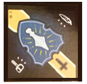

**📖 Chi tiết kỹ năng & Vai trò:**
Kị Sĩ mang tinh thần hiệp sĩ quả cảm xả thân vì chính nghĩa. Duy nhất 1 lần vào ban ngày trước khi cả làng tiến hành biểu quyết treo cổ, Kị Sĩ có quyền dõng dạc lật ngửa lá bài của mình lên và chỉ đích danh 1 người chơi để kiểm tra danh tính. Quản trò lập tức tuyên bố người đó có phải là Ma Sói hay không: Nếu ĐÚNG LÀ SÓI -> Con Sói đó lập tức bị chém chết và ngày hôm đó kết thúc ngay không cần vote tiếp. Nếu KHÔNG PHẢI SÓI -> Kị Sĩ chết gục tại chỗ vì phán đoán sai lầm, và làng tiếp tục chơi bình thường.

**🗣️ Kịch bản Quản trò gọi dậy (GM Call):**
> *"Khi Kị Sĩ lật bài: Quản trò công bố: 'Người này là Sói/Không phải Sói!' -> Thực hiện xử tử tương ứng."*

**⚠️ Lưu ý quan trọng cho Quản trò:**
- Là canh bạc tất tay cực kỳ kịch tính và gay cấn giữa ban ngày.

---

#### 🎴 Con Quạ (Plus) *(Raven Plus)*
- **Phe**: `V` **Phe Dân Làng**
- **Thứ tự thức dậy ban đêm**: `#9.1` (Mỗi đêm)
- **Tóm tắt hiển thị thẻ bài (Card Badge Text)**: *Hằng đêm đặt lời nguyền lên 1 người. Người bị dính lời nguyền sáng hôm sau tự động bị cộng 2 phiếu vote treo cổ.*
- **Hình ảnh lá bài**:
  - Local file: ``
  - Nguồn trực tuyến: ``


**📖 Chi tiết kỹ năng & Vai trò:**
Phiên bản mở rộng của Con Quạ. Hằng đêm thức dậy reo rắc điềm gở lên đầu 1 người chơi. Nạn nhân bị dính lời nguyền sẽ gánh chịu 2 phiếu biểu quyết treo cổ vào sáng hôm sau.

**🗣️ Kịch bản Quản trò gọi dậy (GM Call):**
> *"Quản trò hô: 'Con Quạ thức dậy. Hãy đặt lời nguyền lên một người chơi đêm nay.' -> 'Con Quạ nhắm mắt lại.'"*

**⚠️ Lưu ý quan trọng cho Quản trò:**
- Giúp dồn áp lực biểu quyết lên những kẻ đáng ngờ.

---

#### 🎴 Người Gọi Hồn *(Spiritualist)*
- **Phe**: `V` **Phe Dân Làng**
- **Thứ tự thức dậy ban đêm**: `#3.8` (Mỗi đêm)
- **Tóm tắt hiển thị thẻ bài (Card Badge Text)**: *Mỗi đêm Quản trò hỏi linh hồn người vừa chết gần nhất: 'Hãy chỉ vào kẻ mình nghi ngờ nhất' để Người Gọi Hồn nhìn thấy.*
- **Hình ảnh lá bài**:
  - Local file: ``
  - Nguồn trực tuyến: ``


**📖 Chi tiết kỹ năng & Vai trò:**
Người Gọi Hồn có khả năng giao tiếp và cầu viện linh hồn của người chết gần nhất trong làng. Mỗi đêm, Quản trò gọi Người Gọi Hồn thức dậy, đồng thời ra lệnh cho linh hồn người vừa chết trước đó: 'Người chết, hãy chỉ tay vào người mà bạn nghi ngờ nhất!' Khi đó hồn ma sẽ chỉ điểm nhưng tuyệt đối không được nói bất cứ lời nào. Người Gọi Hồn sẽ chứng kiến sự chỉ điểm đó để làm manh mối điều tra.

**🗣️ Kịch bản Quản trò gọi dậy (GM Call):**
> *"Quản trò hô: 'Người Gọi Hồn thức dậy.' -> 'Người chết gần nhất, hãy mở mắt và chỉ vào kẻ bạn nghi ngờ nhất.' -> Người Gọi Hồn quan sát -> Cả 2 nhắm mắt lại."*

**⚠️ Lưu ý quan trọng cho Quản trò:**
- Người chết chỉ được chỉ tay, không được mở miệng hay phát ra âm thanh.

---

#### 🎴 Sói Lửa (Cáo Lửa) *(Fire Werewolf)*
- **Phe**: `W` **Phe Sói**
- **Thứ tự thức dậy ban đêm**: `#5.8` (Khi có đồng bọn chết)
- **Tóm tắt hiển thị thẻ bài (Card Badge Text)**: *Khi có ít nhất 1 Sói chết, đêm tiếp theo Sói Lửa được chọn 1 người để tước đoạt vĩnh viễn năng lực của người đó. Khi có 2 Sói chết, dùng thêm 1 lần nữa.*
- **Hình ảnh lá bài**:
  - Local file: ``
  - Nguồn trực tuyến: ``


**📖 Chi tiết kỹ năng & Vai trò:**
Sói Lửa mang ngọn lửa hận thù thiêu rụi năng lực đối thủ. Khi bầy Sói có ít nhất 1 con Sói bị tiêu diệt, vào đêm tiếp theo, Sói Lửa được quyền thức dậy chọn 1 người chơi: người bị chọn sẽ bị THIÊU RỤI HOÀN TOÀN NĂNG LỰC VĨNH VIỄN (trở thành một người bình thường không còn phép thuật). Nếu bầy Sói có từ 2 con Sói bị chết trở lên, Sói Lửa được quyền kích hoạt chức năng này thêm một lần nữa.

**🗣️ Kịch bản Quản trò gọi dậy (GM Call):**
> *"Đêm sau khi có Sói chết: 'Sói Lửa thức dậy. Hãy chọn người bạn muốn thiêu rụi năng lực vĩnh viễn.' -> Sói Lửa chỉ định -> Quản trò ghi nhận tước phép nạn nhân."*

**⚠️ Lưu ý quan trọng cho Quản trò:**
- Cực kỳ nguy hiểm cho các chức năng chủ chốt như Tiên Tri, Bảo Vệ hay Phù Thủy.

---

#### 🎴 Anh Em Sói *(Wolf Brothers)*
- **Phe**: `W` **Phe Sói**
- **Thứ tự thức dậy ban đêm**: `#5.3` (Đêm đầu nhận nhau)
- **Tóm tắt hiển thị thẻ bài (Card Badge Text)**: *Gồm Sói Anh và Sói Em. Sói Anh dậy đi săn bình thường. Sói Em chưa thức cùng bầy (Tiên Tri/Gấu soi ra Dân). Khi Sói Anh chết, Sói Em nổi giận giết 1 người và chính thức nhập bầy.*
- **Hình ảnh lá bài**:
  - Local file: ``
  - Nguồn trực tuyến: ``

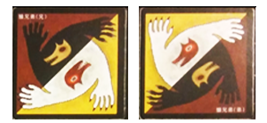

**📖 Chi tiết kỹ năng & Vai trò:**
Đêm thứ nhất, Quản trò gọi 2 Anh Em Sói thức dậy nhận biết nhau và phân định rõ ai là Sói Anh, ai là Sói Em. Sói Anh dậy đi săn cùng bầy Sói như bình thường. Sói Em chưa được thức dậy cùng bầy Sói. Đặc biệt: Chừng nào Sói Anh chưa chết, Sói Em sẽ KHÔNG BỊ Tiên Tri, Gấu hay Cáo nhận diện là Ma Sói (soi ra Dân làng)! Khi Sói Anh chết, Sói Em phẫn nộ lập tức giết chết 1 người và từ đêm đó chính thức thức dậy đi săn cùng phe Sói.

**🗣️ Kịch bản Quản trò gọi dậy (GM Call):**
> *"Đêm 1: 'Hai Anh Em Sói thức dậy nhận nhau.' Quản trò chỉ rõ Sói Anh và Sói Em. Khi Sói Anh chết: Sói Em giết 1 người và kích hoạt hóa Sói hoàn toàn."*

**⚠️ Lưu ý quan trọng cho Quản trò:**
- Là quân bài ngụy trang nội gián hoàn hảo trong lòng dân làng.

---

#### 🎴 Ảnh Tử (Bóng Ma) *(Shadow)*
- **Phe**: `?` **Tùy Thuộc / Kế Thừa**
- **Thứ tự thức dậy ban đêm**: `#0.4` (Đêm đầu tiên)
- **Tóm tắt hiển thị thẻ bài (Card Badge Text)**: *Đêm đầu chọn 1 người làm bản thể. Nếu người đó sống đến cuối, Ảnh Tử thắng theo Dân làng. Nếu người đó chết, Ảnh Tử lấy lá bài đó và kế thừa vai trò.*
- **Hình ảnh lá bài**:
  - Local file: ``
  - Nguồn trực tuyến: ``


**📖 Chi tiết kỹ năng & Vai trò:**
Ảnh Tử là chiếc bóng bí ẩn sống ký sinh trên vận mệnh của người khác. Đêm đầu tiên, Ảnh Tử thức dậy và chọn 1 người chơi làm 'chủ thể'. Trong suốt ván chơi, nếu người được chọn vẫn còn sống, Ảnh Tử có điều kiện thắng hệt như phe Dân Làng. Nếu người chủ thể đó bị chết, Ảnh Tử sẽ lập tức lấy lá bài của người đó và biến đổi trở thành chính nhân vật đó tiếp tục cuộc chơi.

**🗣️ Kịch bản Quản trò gọi dậy (GM Call):**
> *"Đêm 1: 'Ảnh Tử thức dậy. Hãy chọn người bạn muốn gắn kết chiếc bóng.' -> Ghi nhận chủ thể. Khi chủ thể chết: Trao thẻ chủ thể cho Ảnh Tử."*

**⚠️ Lưu ý quan trọng cho Quản trò:**
- Luôn tìm cách bảo vệ người mình đã chọn hoặc toan tính thừa kế những vai quyền lực.

---

#### 🎴 Kẻ Báo Thù *(Avenger)*
- **Phe**: `?` **Tự Chọn Phe (Dân hoặc Sói)**
- **Thứ tự thức dậy ban đêm**: `#0.6` (Đêm đầu chọn phe)
- **Tóm tắt hiển thị thẻ bài (Card Badge Text)**: *Đêm đầu bí mật chọn theo Dân hoặc Sói. Khi Kẻ Báo Thù chết, được chọn 1 người: nếu người đó thuộc phe đối lập với phe mình chọn ban đầu, người đó chết ngay lập tức!*
- **Hình ảnh lá bài**:
  - Local file: ``
  - Nguồn trực tuyến: ``

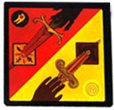

**📖 Chi tiết kỹ năng & Vai trò:**
Vào đêm thứ nhất, Kẻ Báo Thù thức dậy và bí mật ra dấu cho Quản trò chọn theo phe Dân Làng HOẶC phe Ma Sói. Vào đêm mà Kẻ Báo Thù bị giết chết, Kẻ Báo Thù được quyền chọn 1 người chơi để trả thù: Nếu người đó thuộc phe ĐỐI LẬP với phe Kẻ Báo Thù đã chọn ban đầu (ví dụ Kẻ Báo Thù chọn Dân mà người bị chỉ là Sói, hoặc Kẻ Báo Thù chọn Sói mà người bị chỉ là Dân) -> người đó sẽ chết ngay lập tức!

**🗣️ Kịch bản Quản trò gọi dậy (GM Call):**
> *"Đêm 1: 'Kẻ Báo Thù thức dậy. Hãy chọn phe bạn tôn thờ (Dân hay Sói).' Khi Kẻ Báo Thù chết: 'Hãy chỉ một người để kích hoạt báo thù.' -> Kiểm tra phe đối lập -> Xử tử nếu đúng phe đối nghịch."*

**⚠️ Lưu ý quan trọng cho Quản trò:**
- Nếu người bị chọn cùng phe với Kẻ Báo Thù chọn ban đầu thì người đó không bị hề hấn gì.
- Không phải phe thứ 3 độc lập mà gắn liền số phận với phe đã chọn.

---

## 6. GỢI Ý THIẾT LẬP BÀN CHƠI CHO QUẢN TRÒ (PRESETS)

### 6.1. Thiết Lập 6 - 8 Người Chơi (Bàn Nhỏ / Cơ Bản)
- **Phe Sói (2)**: 2 Ma Sói thường (hoặc 1 Sói thường + 1 Sói con)
- **Phe Dân Chức Năng (3)**: 1 Tiên Tri, 1 Bảo Vệ, 1 Phù Thủy (hoặc Thợ Săn)
- **Dân Làng (2-3)**: 2-3 Dân Làng thường

### 6.2. Thiết Lập 9 - 12 Người Chơi (Tiêu Chuẩn)
- **Phe Sói (3)**: 2 Ma Sói thường, 1 Sói Lớn Xấu Xa (hoặc Sói Trắng / Chó Sói)
- **Phe Dân Chức Năng (5)**: 1 Tiên Tri, 1 Bảo Vệ, 1 Phù Thủy, 1 Thợ Săn, 1 Cupid
- **Dân Làng (3-4)**: 3-4 Dân Làng thường (hoặc Hai Chị Em / Già Làng / Cáo)

### 6.3. Thiết Lập 13 - 16 Người Chơi (Mở Rộng Sôi Nổi)
- **Phe Sói (4)**: 3 Ma Sói, 1 Người Cha Của Sói (hoặc Sói Lửa / Sói Trắng)
- **Phe Thứ Ba (1)**: 1 Người Thổi Sáo hoặc Thiên Sứ
- **Phe Dân Chức Năng (6)**: 1 Tiên Tri, 1 Bảo Vệ, 1 Phù Thủy, 1 Thợ Săn, 1 Cupid, 1 Hiệp Sĩ Kiếm Gỉ
- **Dân Làng & Biến Đổi (4-5)**: Ba Anh Em, Đứa Trẻ Hoang Dã, Thằng Ngốc, Dân Làng

---
*Tài liệu được khởi tạo và biên soạn tự động từ bài phân tích luật Ma Sói của Thủ Thuật Chơi để phục vụ xây dựng Website Game Manager.*